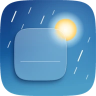

# Animated Weather Card

**Live weather, on your dashboard.**

[](https://github.com/alexsto1an/ha-ani-weather-card/releases)
[](https://my.home-assistant.io/redirect/marketplace_repository/?owner=alexsto1an&repository=ha-ani-weather-card&category=plugin)
[](https://github.com/alexsto1an/ha-ani-weather-card/blob/main/LICENSE)

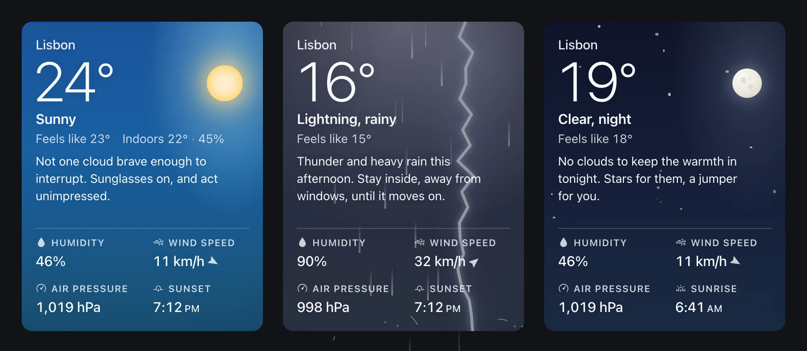

Animated Weather Card turns a Home Assistant weather entity into a living sky. The condition and the time of day set the light. Rain, snow, fog, wind, lightning and clouds move behind the numbers, and the temperature, or the time if you'd rather, is always the first thing you read. Turn on the forecast and you can drag the card through the hours ahead. Under the conditions, your AI can write a note about them. A forecast card and a sun tracker card to match come in the same download.

It's free, open source and made for Home Assistant. You can [try it live](https://alexsto1an.github.io/ha-ani-weather-card/) in your browser first, on sample data.

[Live demo](https://alexsto1an.github.io/ha-ani-weather-card/) · [Install](#install) · [Set up](#set-up) · [Examples](#examples) · [Options](#options) · [Troubleshooting](#troubleshooting)

---

## Weather you can see.

Each condition has its own sky and its own motion, and both follow what your weather entity reports. Rain falls at a steady pace and splashes on the card's lower edge. Snow drifts with the wind, the smaller flakes farther away. Fog drifts in layers, leaves blow across on windy days, and lightning lights the sky from above. The live wind speed sets how fast it all moves, and the weather's own values set how much of it there is: rain and snow by how hard they fall, from your rain rate sensor or the forecast's hour, clouds by the cover, fog by how far you can see, and leaves and gusts by the wind.

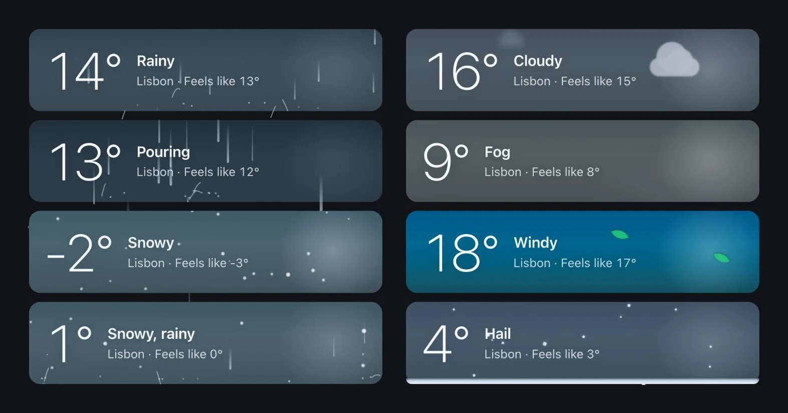

## It follows the sun.

The sky moves through dawn, day, dusk and night with the real sun, read from Home Assistant's `sun.sun`. When the light changes, one sky dissolves into the next over about three seconds. On a clear night the moon is in its real phase, worked out from the date, or kept to your Moon integration's sensor with `moon_entity`.

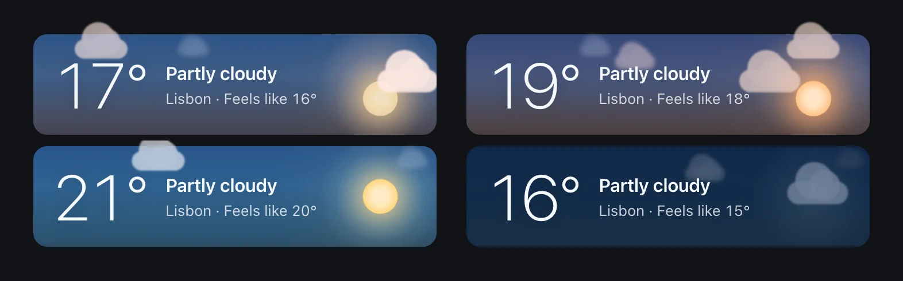

## Your AI writes the note.

Turn on `show_note` and the card hands Home Assistant's AI the hours ahead: when the rain starts and stops, the high and the low, the gusts, the UV, and when you're out, from your calendar. It writes back a line and a longer note, and the card shows whichever fits. Pick its voice: snarky, calm, friendly or dry. Serious weather always gets plain advice. Every screen you're signed in on shares the one note, rewritten as the forecast changes. It needs Home Assistant 2025.8 or later with an AI Task. [Set it up](#a-note-from-your-ai), or [try each voice](https://alexsto1an.github.io/ha-ani-weather-card/#note) in the live demo.

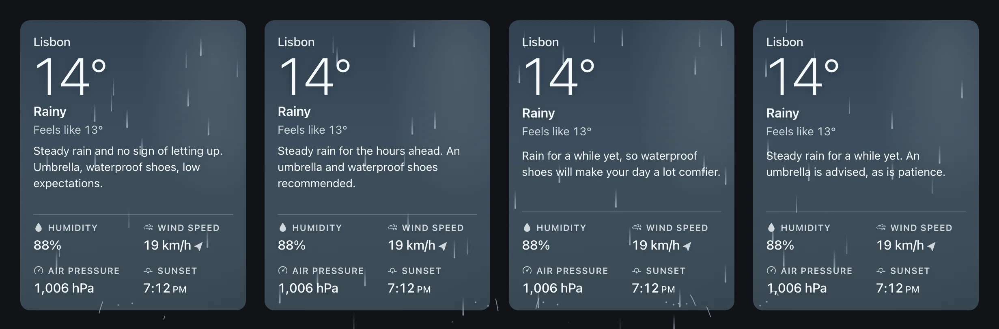

## Drag through the hours.

Turn on `show_forecast` and the card adds today's high and low, a line on what turns ("Rain from 17:00 to 19:00", "Dry all day") and the next hours in a row at its foot, drawn as a line, a soft area or bars. Drag the card sideways and its sky, its weather (as much rain or cloud as that hour has), the temperature and the readings go to the hour you stop at, and stay there until you come back to now. A forecast card, a sun tracker or another weather card on the same weather goes there with it. A tap opens the whole forecast: the hours, the week and every reading your weather entity reports. The forecast also comes as a card of its own, the card can show the time and the date or make the time its big value, and it can be a bedside clock, red on black at night, or a panel you read across the room. [Set it up](#the-forecast-and-the-clock).


## A sun tracker to match.

The download includes a second card, just for the sun. It shows the sun's path across the day, with the next sunrise or sunset as the headline. Below are first light, last light, solar noon, the length of the day and the moon phase. Its sky follows the sun in the same palette as the weather card. South of the equator, the sun crosses it from right to left, as it crosses your sky.

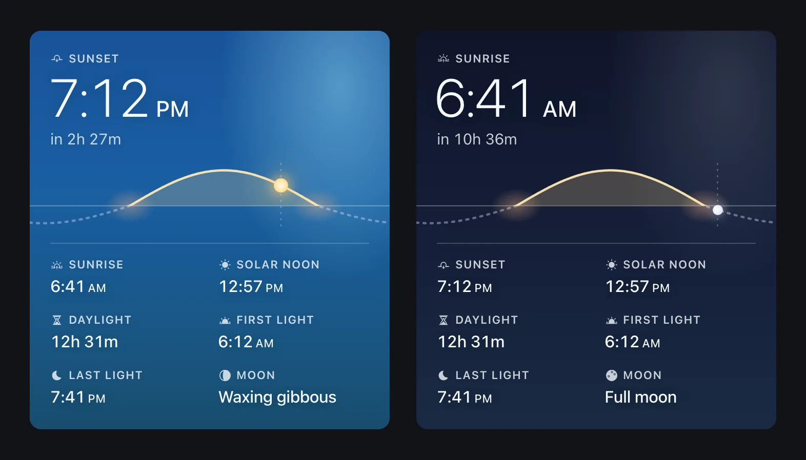

## Better together.

Stack a compact sun tracker under the weather card and the two read as one piece. They share your weather entity's sky, their text lines up, and rain falling out of the weather card passes behind the tracker. With the forecast on, drag the weather card through the hours and the tracker's sun goes there too. [Set it up](#weather-and-sun-tracker).

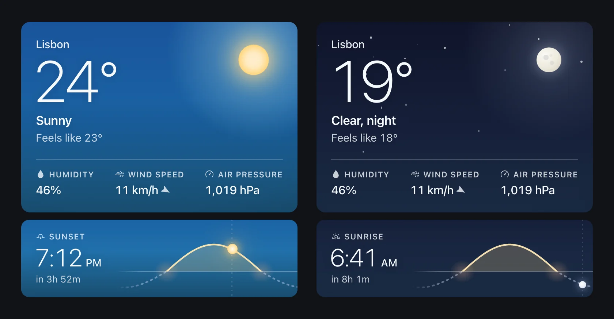

## Fits any frame.

The card works in a narrow phone column, a sections grid or on a wall tablet across the room:

- **Metrics:** they share one row when they fit and fold into a grid when they don't, measured against the actual labels in your language.
- **Wide cards:** the metrics move beside a larger temperature.
- **Wall panels:** with the forecast on, a frame of 640 × 540 px or more lays itself out for reading across the room, every size following the panel's.
- **Short sections rows:** the card steps down to tighter layouts instead of clipping.
- **The forecast:** in a shorter frame, its chips, icons and row give way before the temperature shrinks.
- **One line:** `compact: true` gives you a single strip.

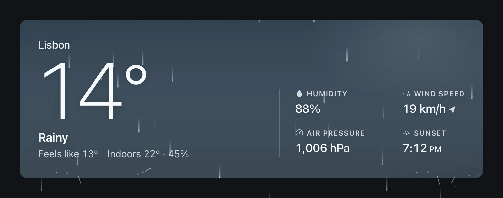

## Planes, actually overhead.

Connect the [Flightradar24 integration](https://github.com/AlexandrErohin/home-assistant-flightradar24) and each flight that enters your area crosses the card once. It flies at its real heading, altitude and speed, with its flight number and aircraft type beside it, or where it's going. Each is drawn as its aircraft, from its type: an airliner, a wide-body, a 747, a regional or business jet, a turboprop, a light aircraft or a helicopter, longer for a longer aircraft. Cruising traffic flies small and high, and arrivals come in lower and larger. After dark, a plane is its lights: green or red at the wingtip facing you, flashing white strobes and a red beacon.

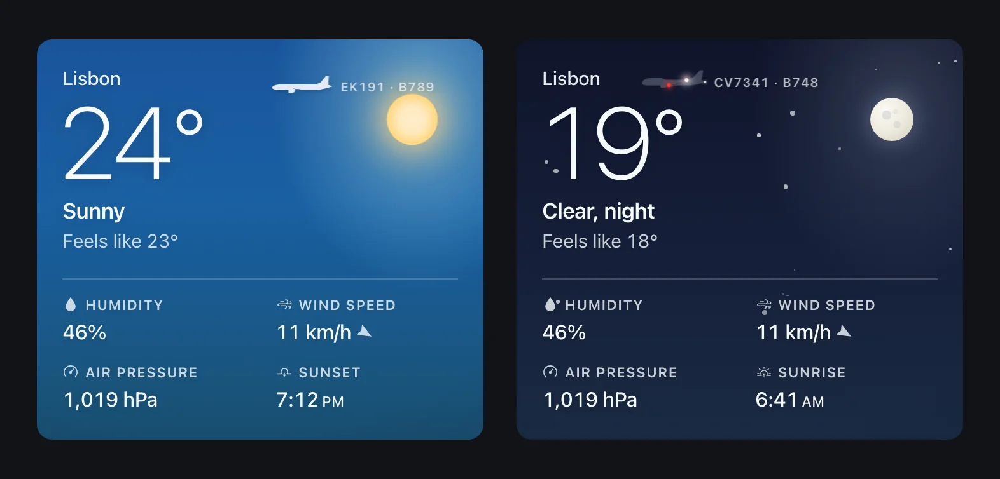

## At home in any theme.

Prefer your dashboard's own look? The theme palette drops the sky and draws the weather in your theme's colours, light or dark. Or keep the sky and recolour it: pick per-condition colours in the editor, or define whole gradients in your theme.

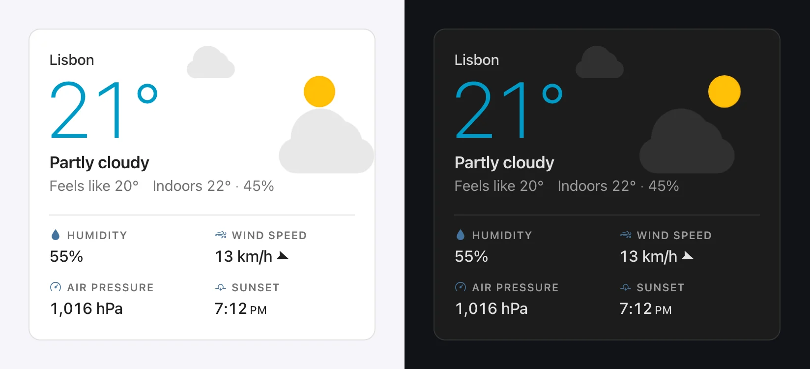

## The details.

- **Speaks your language.** Conditions, the humidity, wind and pressure labels, and the moon phase come from Home Assistant's own translations. The cards' own words, like "Feels like", "Sunset" and the forecast's lines, are in eleven languages, and fall back to English in others. Times follow your profile's 12- or 24-hour setting and its time zone.
- **Your own sensors.** Point the card at your weather station and it shows what they measure: temperature, feels like, humidity, wind and pressure, indoors and out. The sky still follows the forecast.
- **Updates in place.** New readings fade in without a re-render. When the condition changes, the old weather fades out as the new one arrives.
- **Rests when unseen.** Motion pauses while the tab is hidden or the card is scrolled out of view. It can also pause while the window is in the background.
- **Respects reduced motion.** If reduced motion is on in your system settings, the sky stays still: the same colour and light, with no moving weather. The sun stays, and so do a clear night's moon and stars, which don't twinkle.
- **Readable in every sky.** Text sits above the weather, and every built-in sky is tested to meet WCAG AA contrast for the card's text. Screen readers hear temperature and condition changes, and decorative layers are hidden from them.
- **Light to load.** The card is about 104 KB gzipped, with GSAP, its animation library, inside, so it moves without internet access. The visual editor, the forecast, the note writer, the planes and the dev card load only when they're needed.
- **Set up visually.** Every weather card option is in the visual editor. YAML is there when you want it.

## Built with AI.

AI helped build this card. Its code, tests and documentation were developed with an AI assistant, under my direction. I review every change, and each one has to pass the test suite before I merge it. The card runs every day on my own dashboard. If you'd rather not use software made with AI, you know before you install.

---

## Install

The [setup guide](https://alexsto1an.github.io/ha-ani-weather-card/setup/) walks through every step, from the Marketplace to the weather note, with troubleshooting.

### What you need

- **A weather entity.** Any weather integration works: Met.no, OpenWeatherMap, AccuWeather, Pirate Weather, the National Weather Service and others. The card's forecast reads the one your integration already provides: its row of hours needs an hourly forecast, and a daily or twice-daily one gives the rest. The forecast needs Home Assistant 2023.9 or later.
- **Optional:** an AI integration with an AI Task (Home Assistant 2025.8 or later) for the weather note, the [Moon](https://www.home-assistant.io/integrations/moon/) integration for the tracker's moon phase (the weather card's moon works out its phase without it), and the [Flightradar24 integration](https://github.com/AlexandrErohin/home-assistant-flightradar24) for planes.

The card ships as six files that sit in the same folder:

| File | What it is |
| --- | --- |
| `animated-weather-card.js` | The cards. This is the only dashboard resource, and the Marketplace adds it for you. |
| `animated-weather-card-editor.js` | The visual editors for the cards. It loads the first time you open a card's settings. |
| `animated-weather-card-note.js` | The note writer. It loads only for cards that write their own note (`show_note`). |
| `animated-weather-card-planes.js` | The planes. It loads only for cards with a flights sensor (`flights_entity`). |
| `animated-weather-card-forecast.js` | The forecast, the clock, the forecast card, the nightstand and the view that opens on tap. It loads only for cards that use one of them. |
| `animated-weather-card-dev.js` | The dev card, for trying the cards on any weather at any time. It loads only for the dev card and cards with `dev_mode: true`, so a manual install can leave it out. |

<!-- ha-marketplace:exclude-start -->
### Marketplace

[](https://my.home-assistant.io/redirect/marketplace_repository/?owner=alexsto1an&repository=ha-ani-weather-card&category=plugin)

1. Select the button above, or go to **Settings → Marketplace** and search for **Animated Weather Card**.
2. Select **Install**, check the version, and select **Install** again.
3. Refresh your browser.

If the search doesn't find it, select **Add from link** (top right), enter `alexsto1an/ha-ani-weather-card` and select **Add**. Adding from a link needs a GitHub connection, which the Marketplace asks for.

The Marketplace adds the dashboard resource for you when your dashboards are managed in the UI. For YAML-mode dashboards, its install dialog shows the exact line to add, with a `?v=` for the version. It looks like this:

```yaml
resources:
  - url: /local/community/ha-ani-weather-card/animated-weather-card.js
    type: module
```

New versions show up under **Settings → Updates**.

### HACS, before Home Assistant 2026.11

On older versions, install it with HACS: search HACS for **Animated Weather Card** and select **Download**. If the search doesn't find it, add `https://github.com/alexsto1an/ha-ani-weather-card` under ⋮ → **Custom repositories**, as a **Dashboard**. For YAML-mode dashboards, the resource is `/hacsfiles/ha-ani-weather-card/animated-weather-card.js`.

When you update Home Assistant to 2026.11 or later, the card moves to the Marketplace by itself and keeps getting updates. If your resources are in YAML, a repair asks you to change `/hacsfiles/` to `/local/community/`; the old path keeps working until you do.

### Manual

1. Download [`animated-weather-card.js`](https://github.com/alexsto1an/ha-ani-weather-card/releases/latest/download/animated-weather-card.js), [`animated-weather-card-editor.js`](https://github.com/alexsto1an/ha-ani-weather-card/releases/latest/download/animated-weather-card-editor.js) and [`animated-weather-card-note.js`](https://github.com/alexsto1an/ha-ani-weather-card/releases/latest/download/animated-weather-card-note.js) from the [latest release](https://github.com/alexsto1an/ha-ani-weather-card/releases/latest). Add [`animated-weather-card-forecast.js`](https://github.com/alexsto1an/ha-ani-weather-card/releases/latest/download/animated-weather-card-forecast.js) if you use the forecast, the clock, the forecast card or the nightstand, [`animated-weather-card-planes.js`](https://github.com/alexsto1an/ha-ani-weather-card/releases/latest/download/animated-weather-card-planes.js) if you fly planes, and [`animated-weather-card-dev.js`](https://github.com/alexsto1an/ha-ani-weather-card/releases/latest/download/animated-weather-card-dev.js) if you use the dev card. You can also build them from source with `npm install && npm run build`.
2. Copy the files to your `config/www/` folder. If you had to create `www/`, restart Home Assistant once so `/local/` is served.
3. Go to **Settings → Dashboards → ⋮ → Resources → Add resource** and add:
   - URL: `/local/animated-weather-card.js?v=1`
   - Type: **JavaScript module**

   If Resources isn't shown, turn on Advanced mode in your user profile. For YAML-mode dashboards:

   ```yaml
   resources:
     - url: /local/animated-weather-card.js?v=1
       type: module
   ```

4. Refresh your browser.

To update a manual install, overwrite the files and raise the `?v=` number in the resource URL so browsers fetch the new version. The editor, the forecast, the note writer, the planes and the dev card pick up the same `?v=` automatically.

> **Load the card from one place only.** If you switch between the Marketplace (`/local/community/`) and a manual install (`/local/`), remove the old resource. Otherwise the second copy can't register, and you keep running whichever version loaded first.

<!-- ha-marketplace:exclude-end -->

## Set up

1. Edit your dashboard, select **Add card** and search for **Animated Weather Card**. It starts on your weather entity and `sun.sun`.
2. If you have more than one weather entity, pick the one you want. That's enough to start.
3. The editor opens on seven layouts to [start from](#start-from-a-preset), then the basics: the place name, the sky's colours or your theme's, the forecast and the weather note.
4. Everything else is under **Show all settings**, the advanced settings switch at the top, the layout's own choice among it (regular, compact or nightstand). It adds settings inside the same sections, and five more sections that open when you tap them: **Readings**, **Sky and motion**, **Custom colors**, **Planes** and **Interactions**. The editor remembers it in this browser; it's never part of the card's YAML. Any setting you've changed shows with the switch off too. The forecast card's and the sun tracker's editors open on their basics the same way, with the same switch.

For the sun tracker, search for **Animated Sun Tracker**. It starts on `sun.sun`, with your moon sensor if you have one. For the forecast card, search for **Animated Forecast**. It starts on your weather entity.

In Home Assistant 2026.6 and later, the **By entity** tab suggests the cards too: pick your weather entity, or `sun.sun`, and they're under **Community**. A weather entity gets the weather card in four of its [presets](#start-from-a-preset) (Standard, Forecast, Full info and Strip), and the forecast card and its strip; `sun.sun` gets the sun tracker, regular and compact.

Or in YAML:

```yaml
type: custom:animated-weather-card
entity: weather.forecast_home
```

## Examples

Every example below is a complete card configuration. Replace the entity IDs with your own.

### Start from a preset

The editor opens on seven layouts. Each is a few ordinary options, written into the card's YAML, which you can keep changing. Picking one sets the options that make the layout and leaves the rest as you set them: the entity, your sensors, the readings, the colours, the note, the planes and the actions. It also takes back any size you gave the card, so it asks for the rows it needs.

| Preset | What it writes | In a sections view |
| --- | --- | --- |
| Standard | nothing: the card as it comes | 4 rows |
| Simple | `show_attributes: false`: the sky, the temperature and the condition | 4 rows |
| Forecast | `show_forecast: true`: the next hours under the readings | 8 rows |
| Full info | `show_forecast`, `show_days`, `show_clock` and `show_date`: the time and date, the hours and the week | 12 rows |
| Strip | `compact: true`: one line, to sit under other cards | 2 rows |
| Bedside | `layout: nightstand`: [a clock](#a-nightstand) that goes red on black at night | 6 rows |
| Wall | the forecast with `show_clock` and `show_date`, and `grid_options` of full width and 10 rows | the section's width |

[The wall](#the-wall) needs the card at least 640 × 540 px. In a sections view, open the section's settings and set its **Width** to Double, or put the card in a [panel view](#wall-tablet). In a narrower section it's the forecast with the time and date.


```yaml
type: custom:animated-weather-card
entity: weather.forecast_home
show_forecast: true
show_clock: true
show_date: true
grid_options:
  columns: full
  rows: 10
```

### The essentials

The sky follows `sun.sun` on its own. Add `sun_entity` to also show the next sunset (or, at night, sunrise) beside the other metrics.

```yaml
type: custom:animated-weather-card
entity: weather.forecast_home
sun_entity: sun.sun
```

### Your own sensors

Your sensors take the place of the weather entity's values. The temperature and feels like under it come from `outdoor_sensor_entity` and `feels_like_entity`; without `feels_like_entity`, the card uses the entity's apparent temperature if it reports one. Indoor readings sit under the condition. The readings in the row take their sensors in `readings`, below: a wind speed sensor there also sets how fast the weather moves, and a wind direction sensor can report degrees or a compass point like `NW`.

```yaml
type: custom:animated-weather-card
entity: weather.forecast_home
name: Garden
sun_entity: sun.sun
outdoor_sensor_entity: sensor.garden_temperature
feels_like_entity: sensor.garden_apparent_temperature
indoor_temperature_entity: sensor.living_room_temperature
indoor_humidity_entity: sensor.living_room_humidity
readings:
  - type: humidity
    entity: sensor.garden_humidity
  - type: wind
    entity: sensor.garden_wind_speed
    direction_entity: sensor.garden_wind_direction
  - type: pressure
    entity: sensor.barometer
  - sun
```

### The readings

The row under the hero holds humidity, wind, pressure and the next sunset or sunrise. `readings` lists the readings and their order, each a type and, where it needs one or you'd rather, an entity. In the editor they're a list under **Readings**, with **Show all settings** on: a line per reading that opens to its type and its entity, and **Add a reading**. Four fit best: a phone shows them in a row or a 2 × 2 grid, a wide card in two columns. More make more rows.

- **From the weather entity:** `humidity`, `wind`, `pressure`, `uv`, `feels_like`, `dew_point`, `visibility`, `cloud_cover` and `gust` read the weather entity's own value, in its units, unless the row names a sensor (or another weather entity). A sensor that's unavailable falls back to the weather entity. Wind can take a `direction_entity` too, and its sensor sets how fast the weather moves.
- **`sun`:** the next sunset by day and the next sunrise by night, from `sun_entity`.
- **`uv`:** the number and its level, "6 High", on the WHO's scale: low, moderate, high, very high and extreme. On the sky palette its icon also takes the level's colour, from green to violet. `uv_levels` moves where moderate, high, very high and extreme start. Drag the card through the hours and it shows each hour's UV from the forecast.
- **`rain`:** a station's own: today's rain from its sensor, such as an Ecowitt's daily rain, and while it rains, the rate from `rate_entity` ("Rain now, 1.2 mm/h"), each in its sensor's unit.
- **`aqi`:** air quality from a sensor, as the number and its level on the US EPA scale: good, moderate, unhealthy for some, unhealthy, very unhealthy and hazardous, its icon coloured by the level on the sky palette. `aqi_levels` moves where the levels after good start, for a sensor on another scale.
- **`sensor`:** any entity, as Home Assistant words its state, under its `name` or its own.
- **In the view that opens on tap:** a row with `view: true` shows there and not in the card's row. `uv_max` (today's highest UV) and a station's `rain_event`, `rain_week`, `rain_month` and `rain_year` always do. The view also shows the card's air quality and sensors.

A reading that needs a sensor and names none isn't shown. One whose sensor hasn't reported yet shows "--" until it does. Drag the card through the hours and every reading the forecast reports goes to the hour, in the weather entity's units; the rest stay as they are.


```yaml
type: custom:animated-weather-card
entity: weather.forecast_home
sun_entity: sun.sun
readings:
  - humidity
  - wind
  - type: uv
    entity: sensor.current_uv_index
  - type: rain
    entity: sensor.gw2000_daily_rain
    rate_entity: sensor.gw2000_rain_rate
  - type: aqi
    entity: sensor.air_quality_index
  - type: sensor
    entity: sensor.office_co2
    name: CO₂
  - type: uv_max
    entity: sensor.max_uv_index
  - type: rain_week
    entity: sensor.gw2000_weekly_rain
```

Cards set up before `readings` keep working: `metrics`, `show_sun`, the reading sensors (`humidity_sensor_entity`, `wind_speed_sensor_entity`, `wind_direction_sensor_entity`, `pressure_sensor_entity`), `uv_entity`, `uv_max_entity` and the `rain_*` sensors make the same list. With `readings`, they're ignored, and the editor's table replaces them the first time you change it.

### Weather and sun tracker

This is the pairing in the screenshot above. Readings without `sun` leave the next sunset to the tracker, which frees a slot so the weather card's three remaining metrics can share one row. The tracker takes the sky of the weather card on its sun; `weather_entity` names the weather when the dashboard has more than one, or none. With the forecast on, drag the weather card through the hours and the tracker's sun goes there too.

```yaml
type: vertical-stack
cards:
  - type: custom:animated-weather-card
    entity: weather.forecast_home
    sun_entity: sun.sun
    moon_entity: sensor.moon_phase
    readings: [humidity, wind, pressure]
  - type: custom:animated-sun-tracker-card
    sun_entity: sun.sun
    moon_entity: sensor.moon_phase
    weather_entity: weather.forecast_home
    compact: true
```

### Weather in another place

A card can show the weather somewhere else, such as where your family lives. Give it a weather entity for that place, such as a second Met.no location added under **Settings → Devices & services**, and the place's `latitude`, `longitude` and `time_zone`. The card works out that place's sun from its coordinates, the way Home Assistant works out `sun.sun` for yours. Its sky turns to night when night falls there, and its sunset reading and its moon are that place's. So is a clear sky: a weather entity that says sunny or clear night by your own sun reads as a clear night once the place's sun has set, and sunny once it's up. The clock, the forecast's hours and every time it shows are in the place's time zone. The sun tracker takes the same three options instead of `sun_entity`, and on the same coordinates it pairs with the weather card, as on the same sun. The coordinates win over `sun_entity`, which can only be your own `sun.sun`. Sun2's sensors aren't a sun entity, so for a second place, give the coordinates.

```yaml
type: vertical-stack
cards:
  - type: custom:animated-weather-card
    entity: weather.sydney
    name: Sydney
    latitude: -33.87
    longitude: 151.21
    time_zone: Australia/Sydney
  - type: custom:animated-sun-tracker-card
    latitude: -33.87
    longitude: 151.21
    time_zone: Australia/Sydney
    compact: true
```

### Two strips

Both cards in compact form. Together they take about 200 px: the temperature, the condition and the next sunrise or sunset.

```yaml
type: vertical-stack
cards:
  - type: custom:animated-weather-card
    entity: weather.forecast_home
    compact: true
  - type: custom:animated-sun-tracker-card
    sun_entity: sun.sun
    weather_entity: weather.forecast_home
    compact: true
```

### Sections view

The cards size themselves in the sections view, and you can resize them freely:

- **Weather card:** 12 columns × 4 rows by default, 12 × 5 with a note, or 12 × 2 compact. With the forecast, 12 × 8, or 12 × 5 when your weather entity has no hourly forecast, and one more with a note. As a nightstand, 12 × 6. The clock adds no rows.
- **Forecast card:** 12 × 7, 12 × 5 with three days or fewer, or 12 × 2 as a strip. Without the hours, as many rows as its days need: five for a week.
- **Sun tracker:** 12 × 6 by default, or 12 × 2 compact.

If you give a card fewer rows, it steps down to fit, and stops at the first layout that does:

1. The line under the condition goes first.
2. Then the temperature shrinks.
3. Then the location goes.
4. Then the metric labels go, and the temperature shrinks again.

A note gives way before any of these: the spacing tightens to keep it whole, then it shortens to one line, then the temperature shrinks to keep that, then it goes. The forecast gives way before the temperature too: its chips, then its icons, then its row, then the line on what turns. [The forecast and the clock](#the-forecast-and-the-clock) has the details.

On a phone, the default four rows show the card without its location and without the line under the condition, with the metrics and their labels in a grid. With a note, its five rows keep everything, with a smaller temperature and the note on one line.

```yaml
type: custom:animated-weather-card
entity: weather.forecast_home
sun_entity: sun.sun
grid_options:
  columns: 12
  rows: 3
```

### Wall tablet

A panel view gives the card the whole screen. Above 640 px wide, the metrics move to the right of a larger temperature. With `show_forecast`, a frame this size lays out [the wall](#the-wall) instead, as the [Wall preset](#start-from-a-preset) does in a section of Double width. This is a view configuration: paste it in the dashboard's raw configuration editor, under `views:`.

```yaml
title: Weather
type: panel
cards:
  - type: custom:animated-weather-card
    entity: weather.forecast_home
    sun_entity: sun.sun
    indoor_temperature_entity: sensor.living_room_temperature
    indoor_humidity_entity: sensor.living_room_humidity
```

### Blend with your theme

The theme palette uses your dashboard's card background and text colours, in light and dark themes. The temperature and the rain take your theme's accent colour; to keep them white, or any colour, set `temperature_color` and `rain_color` under `custom_colors`, or pick them under **Colors** in the editor.

```yaml
type: custom:animated-weather-card
entity: weather.forecast_home
color_palette: theme
```

### Planes overhead

This needs the [Flightradar24 integration](https://github.com/AlexandrErohin/home-assistant-flightradar24). Each plane is tagged with its flight number and aircraft. Set `flight_label: route` to tag it with where it's going instead, "Lisbon → Paris", or `both` for the route with the flight under it. On a narrow card, a long route shows the airport codes, "FRA → GIG", so it's readable before the plane leaves. A flight with no route, like most light aircraft, keeps its number. Set `show_flight_labels: false` to fly the planes without tags. Planes cross at a pace that follows their real speed and height; set `plane_speed: 0.5` for half that pace, or as low as `0.25`, to follow a plane and read its tag. Only planes that arrive while the dashboard is open fly by; set `planes_on_load: true` to also fly the ones already overhead when it opens.

Each flight is drawn from the side as its aircraft, picked from the ICAO type code Flightradar24 reports: a narrow-body airliner (A320, 737, E190), a wide-body (787, 777, A350), a four-engine jet (747, A380), a jet with its engines at the tail (CRJ, MD-80, and business jets at their own length), a turboprop (ATR, Dash 8), a light aircraft (Cessna, Piper) or a helicopter. An unknown type flies as an airliner. Longer aircraft look longer, though less than in life, so a low 747 never covers the temperature. After dark, with the sky palette, a plane is its lights: steady green at the near wingtip of a plane flying right and red flying left, white strobes that flash twice, a red beacon and a white tail light. With `color_palette: theme` it stays a silhouette in your theme's colour.

```yaml
type: custom:animated-weather-card
entity: weather.forecast_home
sun_entity: sun.sun
flights_entity: sensor.flightradar24_current_in_area
```

### The forecast and the clock

The clock puts the time at the start of the location line: "13:10  Home", with the date after it if you like. Or make the time the big value in the temperature's place. The forecast adds today's high and low beside the condition, a line on what turns under it, and the hours ahead in a row at the card's foot, under the readings. Both read the forecast your weather integration already provides.

```yaml
type: custom:animated-weather-card
entity: weather.forecast_home
sun_entity: sun.sun
show_clock: true
show_forecast: true
# Optional
show_date: true          # the date after the time
hero: clock              # the time as the big value
forecast_metric: chance  # temp, feels, chance, amount, uv, wind, gust, humidity, dew, cloud or pressure
show_chips: false        # no chips: the hours stay on forecast_metric
forecast_graph: bars     # line, area, bars or none
```

**What it shows.**

- **The clock.** It changes only on the minute, and only the figures that change fade. It follows your profile's 12- or 24-hour setting and its time zone, the server's or the device's, and adds no rows. In a short frame it goes with the location line; on the compact strip it leads the quiet line.
- **The date.** `show_date` puts it after the time, "13:10  Fri 13 Nov  Home", in your language's own order. Where the line runs out of room the date drops its month, then the place steps out; neither is ever cut short.
- **The time as the big value.** `hero: clock` swaps them: the time stands in the temperature's place and size, and the temperature leads the condition's line, "21° Partly cloudy", as on the nightstand. The date, if it's on, leads the location line. While you drag through the hours, the big time shows the hour you're looking at. It keeps short of the sun's light, one size all day, and on the wall the date takes the clock's place.
- **The condition** reads as a word you'd say, "Rain" or "Clear", never "Rainy" or "Clear, night". Beside it, today's high and low: "H 22°  L 12°".
- **What turns.** One line under the condition: "Rain from 17:00 to 19:00", "Rain until 19:00", "Dry all day", "Dry tonight". It's shown whole, in a shorter form, or not at all. With a note shown, the note tells what's coming, so this line steps aside and the line under the condition is the usual one, feels like and indoors.
- **The row.** At the card's foot, under the readings, with the divider between them: now above the line, the hours ahead below it. An hour to a column, about 54 px each, so a phone shows six hours and a wider card more, with an icon every hour and the value on one line.
- **The chips.** Under the row: Temp, Feels like, Rain chance and Rain amount, then the UV index, Wind, Gusts, Humidity, Dew point, Cloud cover and Pressure, one for each value your integration's hourly forecast reports, in full words where they fit. The noun follows what falls, so snow gets "Snow chance". A value your integration doesn't report has no chip, and with fewer than two there are none. `show_chips: false` leaves them all out, and the row stays on `forecast_metric`: a chip you tap changes the row only until the card is drawn again. Where they're more than fit, as on a phone, they keep their short words and scroll sideways, the edges fading where there are more: swipe them, drag them with a mouse, or use a trackpad. A swipe on the chips moves the chips; the row above still moves through the hours. Switching moves the white capsule and re-forms the graph, the same kind for every metric: a line (`forecast_graph: line`, the default), the line over a soft fill (`area`), bars (`bars`), or the values alone (`none`). The temperatures (Temp, Feels like, the dew point) sit on the line; the rest stand over it, and an hour of nothing (no UV at night, no wind, no cloud) shows nothing. The wind's figures carry an arrow showing where it blows. Left and Right move between the chips, Home and End go to the first and last, and `forecast_metric` picks the one the row starts on.
- **The days.** With `show_days: true`, the week comes under the row and its chips, as the forecast card shows it: each day's name, icon, low, a bar and the high, on one scale for the week. `forecast_days` sets how many (7 by default). They follow the chips and the hour you drag to. They ask for a row more for every two days in a sections view, and in a shorter frame they give way first, from the end down to three, then all of them, before the chips. On a wall-size card, the wall shows its own five days.
- **The icons.** One filled set, with a sun, a moon, clouds, rain, snow, a bolt and wind, each condition in its own drawing, and the same set draws the weather card's and the sun tracker's icons. On the sky palette each stands in the light of its own hour: white by day, rose at dawn, peach at dusk, slate at night, with the sun gold and rain pale blue. Only the colour changes, and each colour is lightened until it holds 3.2:1 against the brightest sky it can sit over. On the theme palette they take Home Assistant's icon colour.

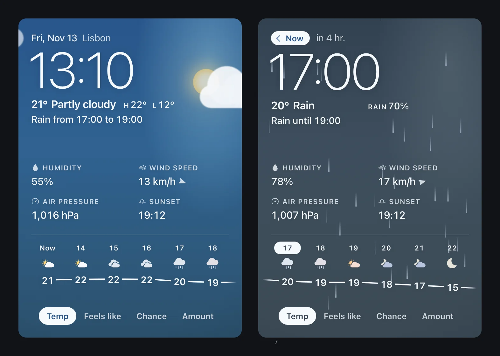

**Drag through the hours.**

- **The card goes there.** Drag the card sideways, on the row, on a chip or anywhere else on it, and the row moves under a fixed needle. The card's real sky, its light, sun, clouds, fog, wind, rain, snow and lightning, the temperature, the condition, the line on what turns, and the humidity, wind and pressure go to the hour under it. Where the row has given way, a thin rail on the divider is the ruler.
- **It stays where you leave it.** A slow lift settles on the nearest hour. A flick carries on, the way a list does, and lands on the hour it was heading for. The next drag continues from there, so a few swipes reach two days ahead.
- **The needle names the hour.** When you take hold of the hours, "Now" lifts into a white capsule over the first column. It holds still while the hours slide under it, naming the one beneath it, and the hours fade as they reach it, so none shows twice. On the way home it counts the hours back, then settles into "Now" again.
- **It says so.** While the card shows another hour, the location line becomes "‹ Now  16:00  in 3 hr.": the Now control, the hour, and how far ahead it is. On the compact strip, the quiet line under the condition says it. Today's high and low step out, and the hour's chance of rain takes their place.
- **Coming home.** The card comes back to now when you tap **Now**, press Home or Escape, leave it alone for half a minute, scroll it off screen or hide the page, and when a new forecast arrives. It comes home on one quick spring: the row, the sky and every layer of weather go straight from the hour you left to now.
- **You can catch it.** A press while it moves stops it where it is. Nothing changes when your finger first lands.
- **The other cards follow.** A forecast card on the same weather goes to the hour with it: its row, its sky and its days, which show the day the hour falls in (its name in bold, a dot on its bar at that hour's temperature, the other days stepping back). It works both ways: drag the forecast card and the weather card goes along, and whichever you touch leads. A forecast card without hours shows the day and takes the hour's sky, and with `weather_effects` on, the hour's rain, snow, fog, wind and lightning too. A weather card on the same weather without `show_forecast` goes to the hour as a whole: its sky and weather, the temperature, the condition and the readings, with the hour on its location line (on the compact strip, its quiet line, and beside the condition where the location line has given way). It only follows: it has no row, takes no drag of its own, its tap is unchanged, and it loads nothing until a card on its weather is dragged. A sun tracker on the same sun moves its sun to the hour you're on and takes the card's sky when it shows the same weather: its `weather_entity`, or without one, the weather card's on its sun. The tracker takes only the sky's colour. They come back to now together.
- **The page still scrolls.** A drag up or down scrolls the dashboard; the card takes only a drag that's clearly sideways. On a trackpad, swipe sideways with two fingers.
- **Keyboard and screen readers.** The hours are a slider you can Tab to: the arrows step an hour, Page Up and Page Down three, and Home or Escape come back to now. A screen reader hears "16:00, in 3 hr.: Cloudy, 22°, 40% chance". The row also has a list of the next 24 hours for screen readers, and the chips are a group of choices with their full names, such as "Chance of rain".
- **Reduced motion.** With reduced motion, or `animate: false`, the sky stays still and steps with the hour, the row still follows your finger, the chips swap without moving, and the way home is a short fade.

On the compact strip (`compact: true`), there's no row: drag the strip and a rail shows under it while its sky and numbers go to the hour.

**How it fits.** With an hourly forecast, the card asks the sections view for eight rows. In fewer, the forecast gives way before the temperature ever shrinks:

1. The chips go first (seven rows).
2. Then the icons (six).
3. Then the row, which leaves the line on what turns and the rail (five rows). At four, the line's short form sits beside the condition instead.
4. Then the line itself.

Only then does the card step down as it always has. With a note, the note first shortens to its one line. The row is kept only where its first line sits low enough in the card for its text to stay readable over the sky's light. From 640 px wide, the row sits in the temperature's column and shows eight hours.

**Your forecast.** The row needs an hourly forecast. With only a twice-daily or daily forecast there's no row: the card asks for five rows, and the rail steps through half days or days. With no forecast at all, the card is today's card. Temperatures in °F, rain in millimetres or inches, and wind and pressure in the entity's units all work. The page subscribes to each entity's forecast once, and the weather card, the forecast card, the view on tap and the note writer share it.

### The view that opens on tap

With the forecast on, a tap opens the whole forecast. The card's own sky grows from the card into the screen, and the temperature, the condition, the line, the row and the chips travel with it. It holds:

- the clock and the place (with the date if it's on), the temperature, the condition with today's high and low, and the line on what turns; with `hero: clock`, the time is the big value here too, and the temperature leads the condition
- the row and its chips, which drag and stay where you leave them, as on the card
- seven days with their ranges, eight on a tablet. As you drag the row, the days show the day the hour falls in, and the chips change what the days show too, as on the forecast card
- every reading your weather entity reports: feels like, wind with its gusts, humidity, dew point, UV, cloud cover, precipitation, visibility and pressure. While you're at another hour, they're that hour's ("At 17:00").
- **History and settings**, which opens Home Assistant's own dialog for the entity

Close it with ×, Escape, Back, a tap outside it, or a swipe down on a phone, where it starts just below the status bar. It's a dialog: focus moves into it, the page behind it can't be reached, and focus comes back to the card when it closes. On a tablet, 900 px and wider, it has two columns and nothing scrolls, unless the readings make the right column taller than the screen, as a weather station's can: then that column scrolls. It's built ahead of time, hidden and with its weather paused, so it opens on the next frame. The row in the view doesn't come home on its own; it does when the view closes.

To have a tap do something else, set `tap_action`, or pick it under **Interactions** in the editor.

### The wall

With the forecast on, a card of at least 640 × 540 px, such as two sections columns by ten rows on a wall tablet (the [Wall preset](#start-from-a-preset)), a panel view or a TV, lays itself out for reading across the room. Every size follows the panel's, so a bigger screen is the same picture seen from further away.

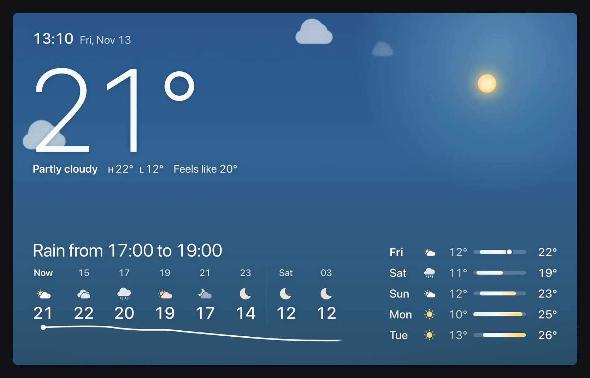

What it shows:

- top left, on one edge: the time and the date, the temperature (about a third of the panel's height), and the condition with the high, the low and feels like
- open sky, where the sun and the clouds are
- at the foot, the line on what turns over the hours: two-hour columns of time, icon and temperature on one line each, with the temperature's line under them (eight on a 1280 × 800 tablet, from three or four on the smallest wall to ten on a TV)
- beside the hours, set apart, five days of ranges, each row on one of the hours' lines; they show the day the hour falls in as you drag
- on a portrait tablet, the week goes under the hours, seven days where there's room

There are no chips, and the slide works the same: let go and the row settles on a labelled hour.

```yaml
title: Weather
type: panel
cards:
  - type: custom:animated-weather-card
    entity: weather.forecast_home
    sun_entity: sun.sun
    show_forecast: true
```

### A nightstand

`layout: nightstand` makes the weather card a bedside clock. The time is the hero, "3:12" with no leading zero, and the weather says what the hour needs. It asks the sections view for six rows, and a tap does nothing unless you set `tap_action`.

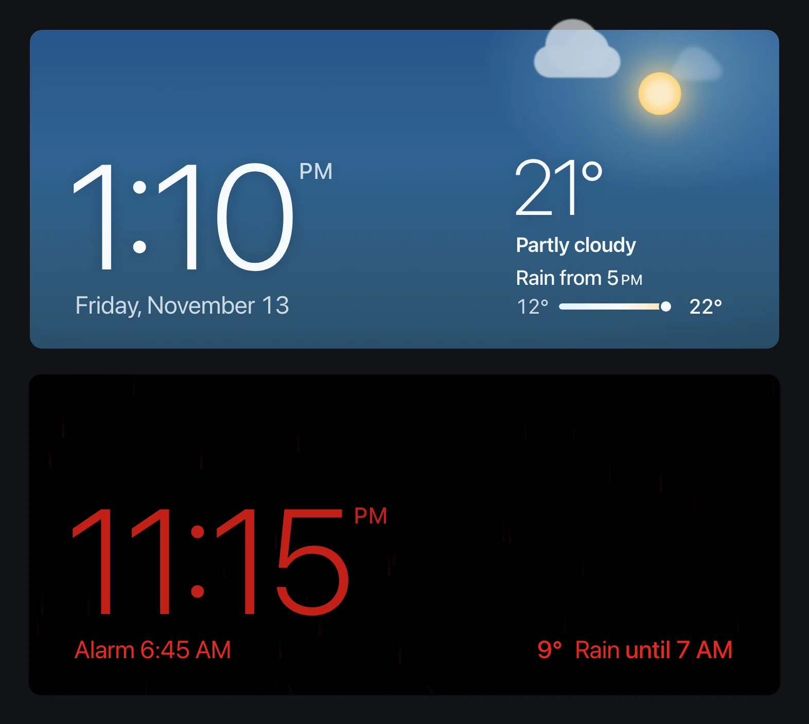

```yaml
type: custom:animated-weather-card
entity: weather.forecast_home
layout: nightstand
# Optional
alarm_entity: sensor.phone_next_alarm
night_sensor: sensor.bedroom_illuminance
wake_time: "07:00"
```

- **By day:** the date, the temperature, the condition, the line on what turns, and today's range with a dot for now. From an hour before bed time, with an alarm set, the alarm takes the date's place.
- **At night:** the card goes red on black, like a bedside clock's night mode: no sky, and a deep red for the time, the alarm ("Alarm 6:45") and one line, which keeps a dark room's night vision. The weather still moves behind them, very faintly, in the same red: rain, snow, clouds, the moon and the stars. With `night_red: false` it turns its real sky down under a veil instead, and the words keep two warm colours with no transparency. Dawn, day and dusk are untouched either way. That line is the temperature and the condition, then what's coming ("16° Partly cloudy · Dry tonight", "9° Rain until 7 AM"), or what's wrong before you're up: severe weather, rain at 60% or more, gusts of 60 km/h (37 mph) or more, or frost at the alarm. A warning is set a step heavier, and screen readers hear it as a status. Nothing changes under the veil but the minute. Night comes and goes over eight seconds.
- **When night falls.** With `night: auto`, the default, a light sensor beside it decides: night under 5 lx held for a minute, day again over 15 lx held for 10 seconds, so a phone screen or a passing car doesn't flip it. If the screen's own glow or a street light keeps the room above 5 lx at night, raise `night_lux`: day comes back at three times it. Without one, night runs from `bed_time` to the alarm, or to `wake_time` without an alarm. `bed_time` defaults to 8 hours 30 minutes before that. `night: on` and `night: off` fix it.
- **The alarm.** `alarm_entity` is a timestamp sensor with your next alarm: the Android Companion app's next alarm sensor, or an input_datetime that an iOS Shortcut sets. The card uses it when it's within 18 hours.
- **Screen care.** The words move by a pixel every 15 minutes, against burn-in.
- **Narrow frames** put the weather under the time.

### The forecast card

`type: custom:animated-forecast-card`

The hours and the week on a card of their own, on your weather entity's sky: the line on what turns as its lead, the row with its chips, and the days. It's the weather card's own engine, so its row works the same way: leave it at 17:00 and its sky goes to that hour, with a "‹ Now" control at the end of the lead to come back. By default it shows the sky alone, its colour and its light, with no weather moving in it; `weather_effects: true` brings in the rain, snow, fog, wind and lightning, which go to the hour too. It has no sun, clouds or stars of its own, so stacked under the weather card there's one sun and, by default, one rain, and it has its own light in the corner. Drag its row and a weather card on the same entity goes to the same hour, its sky, weather and readings too, with or without `show_forecast`; with it, dragging the weather card moves this one in turn. Dragging it also moves a sun tracker on the same sun. A tap opens the view that opens on tap. Search for **Animated Forecast** in the card list, or pick **Forecast** or **Forecast strip** under **By entity**.

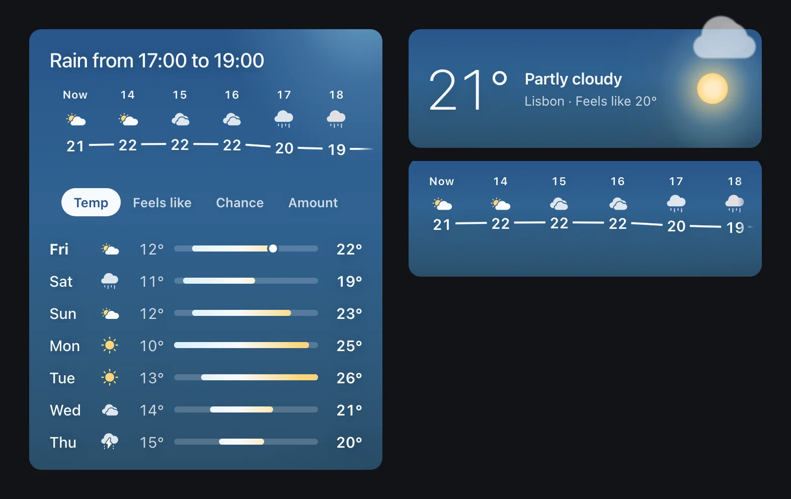

```yaml
type: custom:animated-forecast-card
entity: weather.forecast_home
```

Each day has its name, its icon, the low, a bar and the high; the bar takes the width that's left, so the low sits by the icon. The bars share one scale for the week, from the coldest low to the warmest high, and their colour is set by the temperature: the sky's blue-white for cold, white in the middle and the sun's gold for warm. Today's bar has a dot for now, and as you drag the row the days show the day the hour falls in, with the dot on its bar at that hour's temperature. The chips change what the days show, on this card only: Feels like shows each day's feels-like range (from the hours, and the day's own figure where your integration gives one), the chance and the amount show as bars from zero, the chance on a scale to 100% and the amount to the week's wettest day. The UV index, the wind, its gusts, humidity and cloud cover show each day's own figure as a bar from zero; the dew point and the pressure show it as a mark on the week's scale. A day your integration gives no figure for shows a dash. The bars draw in with one sweep across the scale. On the theme palette, they're one solid colour. From 640 px wide, the hours sit on the left and the week on the right. In a frame shorter than it asks for, the days give way from the end. An entity without a forecast says so: "This weather entity has no forecast".

One value per card: `forecast_metric` sets what the hours and the days show, and `show_chips: false` leaves out the chips that change it. `show_summary: false` leaves out the line at the top too, for the hours and the days alone. A chip you tap on the card changes it only until the card is drawn again; what a card opens on is `forecast_metric`.

```yaml
type: vertical-stack
cards:
  - type: custom:animated-forecast-card
    entity: weather.forecast_home
    forecast_metric: amount   # the rain's amount
    show_chips: false
    show_summary: false       # no line at the top
  - type: custom:animated-forecast-card
    entity: weather.forecast_home
    forecast_metric: temp     # the temperature
    show_chips: false
```

As a strip, it sits under the compact weather card: the hours' labels, icons and line, with no words or chips, its first and last labels on the weather card's text edges.

```yaml
type: vertical-stack
cards:
  - type: custom:animated-weather-card
    entity: weather.forecast_home
    compact: true
  - type: custom:animated-forecast-card
    entity: weather.forecast_home
    compact: true
```

| Option | Default | Description |
| --- | --- | --- |
| `entity` | required | Your weather entity |
| `sun_entity` | — | The sun entity the sky's time of day and the icons' light follow. Without it, `sun.sun` |
| `latitude`, `longitude`, `time_zone` | your Home Assistant's | Another place's coordinates and time zone, as on the weather card: its sun, worked out from the coordinates, and its times |
| `compact` | `false` | The strip: the hours alone, to sit under the compact weather card. Two rows in the sections view |
| `forecast_days` | `7` | How many days the list shows, 0 to 10. `0` leaves the days out |
| `show_summary` | `true` | The line at the top on what turns ("Rain from 17:00 to 19:00"). `false` leaves it out, and the Now control with it: while you drag, the capsule on the row names the hour, and the card comes back when you drag it back, or after half a minute. A narrow card keeps the line's room as sky: any higher, the hours would sit in the corner's light |
| `show_hours` | `true` | Show the hourly row and its chips |
| `weather_effects` | `false` | The weather behind the forecast: rain, snow, fog, wind and lightning, as on the weather card, going to the hour you drag to. Without it, the sky alone |
| `forecast_metric` | `temp` | What the row shows first: `temp`, `feels`, `chance`, `amount`, `uv`, `wind`, `gust`, `humidity`, `dew`, `cloud` or `pressure`. One your integration doesn't report starts on the temperature |
| `show_chips` | `true` | The chips under the hours, which change what the hours and the days show. `false` leaves them out, so the card stays on `forecast_metric`; the view on tap keeps them |
| `forecast_graph` | `line` | The hours' graph, the same for every metric: `line`, `area` (the line over a soft fill), `bars`, or `none` (the values alone) |
| `color_palette` | `default` | `default` for the sky, or `theme` for your dashboard's colours |
| `dev_mode` | `false` | The card always runs on the [dev card](#the-dev-card)'s simulated weather, and needs no `entity`, as the weather card's `dev_mode` |
| `tap_action` | `forecast` | What a tap does. By default it opens the view that opens on tap. Takes the same actions as the weather card |
| `hold_action` | `none` | What a press of half a second or more does |
| `double_tap_action` | `none` | What a double tap does |

The weather card's `animate` and `custom_colors` work on it too. With `weather_effects`, so do `spill_particles`, `gpu_snow`, `gpu_rain`, `engine_mode` and `engine_settings`. With `outdoor_sensor_entity` its reading for now comes from your own sensor.

In the sections view it asks for 12 × 7, or 12 × 5 with three days or fewer. Without the hours, it asks for as many rows as its days need: five for a week.

### A note from your AI

The card can write a sentence under the conditions: a remark on the weather, what's coming in the next hours and what to wear. It's snarky by default.

```yaml
type: custom:animated-weather-card
entity: weather.forecast_home
sun_entity: sun.sun
show_note: true
# Optional
note_tone: calm                 # snarky, calm, friendly or dry
note_calendar: calendar.family  # when you're out, for what to wear
```

**What it needs.** Home Assistant writes the note with its AI Task, so it works with whichever AI you've set up there. You need Home Assistant 2025.8 or later and an AI integration that provides an AI Task: OpenAI, Google, Ollama, OpenRouter, Anthropic (2025.12 or later) or Home Assistant Cloud. The card uses the default AI Task from Settings → System → AI, or the one you name in `note_ai_task_entity`. Your API key stays in Home Assistant; the card never sees it.

**How it's written.**

- **Facts first.** The card reads the hourly forecast and works out what it says: when the rain starts and stops, the high and low, gusts, UV, and how it'll feel when you're out. The AI only puts those facts into words, and is told never to invent a time or a temperature.
- **Four voices.** `snarky`, the default, is theatrical and a little unhinged, in the spirit of CARROT Weather: the weather has motives and the joke lands at the end. `calm` is plain and impersonal, like Apple Weather. `friendly` talks to you like a friend who checked the forecast for you. `dry` is deadpan: short, flat and mildly unimpressed.
- **Your calendar.** With `note_calendar`, the card reads the next 12 hours of events and says what to wear for each stretch you're out. Timed events count; all-day, cancelled and online ones (a location that's a link) don't, and events less than half an hour apart count as one stretch. Only the times reach the AI, never an event's name, place or description.
- **Serious weather gets no jokes.** Thunderstorms, hail, heavy rain, gale-force gusts and dangerous cold or heat switch any voice to plain advice.
- **Your language.** It writes in your profile's language, with your units and your 12- or 24-hour clock.
- **Two lengths.** It writes a one-line version for short frames and a longer one where there's room, and shows one whole or not at all.
- **No stale flash.** When you come back to the card and a new note is due, a short status takes its place while it's written (reading the forecast, then writing the note), and the new note types itself in, rather than the old one showing first. With reduced motion, it's simply there.

**What it costs.** The note is rewritten after an hour, or sooner when the forecast changes, and only while a screen is showing the card. Every screen you're signed in on shares one note, through your Home Assistant user. Each note is one small request, about 1,000 tokens in and 60 out: with the settings below, about $0.20 a month for a card on all day.

If there's no AI Task, or a note can't be written, the card shows no note and is otherwise the same. The browser console says why, and so does the editor.

#### Choosing the AI

The card has already worked out the facts, so the AI only writes two short sentences. A small, fast model does it best, with as little thinking as it allows: thinking adds seconds and cost to every note, and nothing to it. Set this up in the AI integration's **AI Task** options (Settings → Devices & services → the integration → the AI Task's settings), not its conversation agent's, then make it the default in Settings → System → AI or pick it in the card's editor.

**Anthropic.** Home Assistant's recommended settings use Claude Haiku 4.5 with thinking on. Turn **Recommended** off and choose:

| Setting | Choose |
| --- | --- |
| Model | `claude-haiku-5-5`, newer and about a tenth of Haiku 4.5's price |
| Maximum tokens | 3000, the default. It's only a ceiling; lower risks a note cut off, and then none |
| Thinking effort | Low, the least Haiku 5.5 offers |
| Code execution, web search, web fetch | Off |

On Haiku 4.5, set **Thinking budget** to 0 instead: anything under 1024 turns thinking off.

**OpenAI.** Home Assistant's recommended model is `gpt-4o-mini`, which OpenAI retires in January 2027. Turn **Recommended** off and choose `gpt-6-luna`, with **Reasoning effort** set to None, and leave web search and the code interpreter off. The image model doesn't matter for the note.

**Other integrations** (Google, Ollama, OpenRouter, Home Assistant Cloud): pick their smallest current model and turn thinking or reasoning down as far as it goes. A local model through Ollama costs nothing per note, but needs to follow a JSON schema: the card asks for structured output.

### A note from an entity

The card can also show a sentence from any entity whose state is text: a text helper, a template sensor, or a summary sensor from your weather integration, such as Pirate Weather's. An entity is used instead of the AI.

- **The state is the one-line version.** Keep it to about 40 characters, so it fits a phone.
- **A `note` attribute, if there is one, is the longer version.** The card shows it where there's room for two lines. Keep it to about 90 characters.
- **A `generated_at` attribute marks when it was written.** The card hides the note 3 hours later (`note_max_age`), so a note about this afternoon's rain isn't still up tonight. The AI's own notes do the same.

With a note, from either source, the card asks the sections view for five rows. On a phone, that's room for the one-line version. With four, the note gives way.

```yaml
type: custom:animated-weather-card
entity: weather.forecast_home
sun_entity: sun.sun
note_entity: input_text.weather_note
```

### Just the numbers

This hides the metric labels and icons, and marks the indoor reading with a house icon instead of the word.

```yaml
type: custom:animated-weather-card
entity: weather.forecast_home
indoor_temperature_entity: sensor.living_room_temperature
indoor_style: icon
show_attribute_labels: false
show_attribute_icons: false
```

### A calmer card

This keeps all the weather inside the card, stops the jolt on lightning strikes, and also pauses while the browser window is in the background. For a sky with no motion at all, set `animate: false`.

```yaml
type: custom:animated-weather-card
entity: weather.forecast_home
spill_particles: false
disable_lightning_shake: true
auto_pause: true
```

### Your own colours

Each `_bg` colour becomes a full sky for that condition: lighter overhead, deeper at the horizon, with the same shading behind the metrics as the built-in skies. It replaces that condition's sky at every time of day.

```yaml
type: custom:animated-weather-card
entity: weather.forecast_home
custom_colors:
  sunny_bg: "#2f80d1"
  cloudy_bg: "#6b7a8f"
  rainy_bg: "#3f5168"
  text_color: "#ffffff"
  rain_color: "rgba(220, 235, 255, 0.8)"
```

### Skies from your theme

For full control, set a sky per condition in a [Home Assistant theme](https://www.home-assistant.io/integrations/frontend/). Any CSS background works. This covers all fifteen skies, including those `custom_colors` doesn't reach, such as pouring and storms. The variable names are listed under [Conditions](#conditions).

```yaml
# configuration.yaml → frontend: themes:, or a file in themes/
my_theme:
  weather-sunny-background: "linear-gradient(180deg, #5aa0e6 0%, #2a6db5 60%, #1d4f87 100%)"
  weather-pouring-background: "linear-gradient(180deg, #4a5566 0%, #2d3542 100%)"
  weather-clear-night-background: "linear-gradient(180deg, #0b1026 0%, #1b2547 100%)"
```

### A stormier sky

In manual mode the weather engine's settings scale the animation, in place of the weather's own amounts. For the editor's slider ranges and what YAML accepts, see [Weather engine](#weather-engine).

```yaml
type: custom:animated-weather-card
entity: weather.forecast_home
engine_mode: manual
engine_settings:
  windSpeed: 3.5
  rainCount: 2
  cloudCount: 5
  cloudBaseSize: 1.3
  splashBounce: 110
```

### Day and night by the clock

This follows fixed hours instead of the sun, for example when your `sun.sun` doesn't match where the dashboard hangs.

```yaml
type: custom:animated-weather-card
entity: weather.forecast_home
enable_day_night_cycle: true
sunrise_hour: 7
sunset_hour: 19
```

## Options

### Weather card

`type: custom:animated-weather-card`

**Entities**

| Option | Default | Description |
| --- | --- | --- |
| `entity` | required | Your weather entity |
| `name` | entity's name | The location shown above the temperature |
| `sun_entity` | — | Usually `sun.sun`. Adds the next sunset (by day) or sunrise (by night) to the metric row. The sky follows it, or `sun.sun` without it. With `latitude` and `longitude`, the card follows that place's own sun instead |
| `moon_entity` | — | A moon phase sensor, such as the Moon integration's `sensor.moon_phase`. A clear night's moon keeps to the phase it names. Without it, the card works the phase out from the date |
| `outdoor_sensor_entity` | — | A temperature sensor to show instead of the weather entity's temperature |
| `feels_like_entity` | — | An apparent temperature sensor. Without it, the card uses the weather entity's `apparent_temperature` if it has one |
| `indoor_temperature_entity` | — | An indoor temperature, shown under the condition |
| `indoor_humidity_entity` | — | An indoor humidity, shown beside it |
| `flights_entity` | — | A Flightradar24 area sensor, usually `sensor.flightradar24_current_in_area` |

**Display**

| Option | Default | Description |
| --- | --- | --- |
| `compact` | `false` | One line about 88 px tall: the temperature and condition, with the location and "feels like" beside them. Two rows in the sections view |
| `temperature_decimals` | `0` | `1` shows the temperature, "feels like" and the indoor temperature to one decimal, `21.5°`, in your language's format. `0` rounds them to whole degrees |
| `show_location` | `true` | Show the location name |
| `show_attributes` | `true` | Show the readings' row |
| `readings` | humidity, wind, pressure, sun | The readings, in order: a type, or a type with its `entity`. See [The readings](#the-readings) and [A reading](#a-reading) |
| `uv_levels` | `[3, 6, 8, 11]` | Where the UV index's moderate, high, very high and extreme levels start, as four rising numbers. The WHO's by default |
| `aqi_levels` | `[51, 101, 151, 201, 301]` | Where air quality's moderate, unhealthy for some, unhealthy, very unhealthy and hazardous levels start, as five rising numbers. The US EPA's by default |
| `show_attribute_labels` | `true` | Show the metric labels |
| `show_attribute_icons` | `true` | Show the metric icons |
| `show_indoor` | `true` | Show the indoor reading |
| `indoor_style` | `label` | How the indoor reading starts: `label` (the word "Indoors", translated), `icon` (a house) or `both` |
| `show_flight_labels` | `true` | Show a tag beside each plane. Tags only appear in open sky, never over the temperature |
| `plane_speed` | `1` | How fast planes cross, from `0.25` (a quarter of their usual pace) to `2`. The editor offers the usual pace, half and a quarter; faster is set in YAML |
| `planes_on_load` | `false` | Also fly the planes already overhead when the dashboard opens, not only those that arrive |
| `flight_label` | `flight` | What a plane's tag says: `flight` (the flight number and aircraft type), `route` ("Lisbon → Paris", or the airport codes on a narrow card) or `both` (the route, with the flight under it). A flight with no route keeps its number |
| `color_palette` | `default` | `default` for the sky, or `theme` for your dashboard's colours |

**Forecast and clock**

| Option | Default | Description |
| --- | --- | --- |
| `show_clock` | `false` | The time at the start of the location line: "13:10  Home". It changes only on the minute and follows your profile's 12- or 24-hour setting and time zone. It goes with the location line in a short frame, and on the compact strip it leads the quiet line. It adds no rows |
| `show_date` | `false` | Today's date after the time, or at the start of the location line without it: "13:10  Fri 13 Nov  Home". It drops its month, then the place steps out, where the line runs out of room; it goes with the location line in a short frame, and on the compact strip it joins the quiet line. The wall and the nightstand always show it |
| `hero` | `temperature` | The big value: `temperature`, or `clock` for the time in the temperature's place and size, with the temperature leading the condition's line ("21° Partly cloudy"). Dragged through the hours, it shows the hour under the needle. `temperature_color` colours whichever is the big value. The nightstand always has the time |
| `show_forecast` | `false` | Today's high and low beside the condition, the line on what turns under it, the hourly row with its chips, and the slide through the hours. A tap opens the forecast view. Eight rows in the sections view, or five without an hourly forecast |
| `forecast_metric` | `temp` | What the row shows first: `temp`, `feels` (feels like), `chance` (the chance of rain), `amount` (the rain amount), `uv` (the UV index), `wind`, `gust` (wind gusts), `humidity`, `dew` (the dew point), `cloud` (cloud cover) or `pressure`. One your integration doesn't report starts on the temperature |
| `show_chips` | `true` | The chips under the hourly row, which change what it shows. `false` leaves them out, and the row and the days stay on `forecast_metric`; the view on tap keeps them |
| `forecast_graph` | `line` | The hours' graph, the same for every metric: `line`, `area` (the line over a soft fill), `bars`, or `none` (the values alone). The view on tap and the wall follow it; the forecast card has its own |
| `show_days` | `false` | With `show_forecast`, the days under the hourly row and its chips. A row more for every two days in the sections view; in a shorter frame they give way first, from the end |
| `forecast_days` | `7` | How many days `show_days` shows, 1 to 10 |
| `layout` | `default` | `nightstand` makes the card a bedside clock, with the time as the hero. Six rows in the sections view. It draws its own lines, so it has no note (`show_note` and `note_entity` are left alone, and nothing asks your AI), and it's never the compact strip |
| `alarm_entity` | — | Nightstand: a timestamp sensor with your next alarm, such as the Android Companion app's next alarm sensor, or an input_datetime an iOS Shortcut sets. It's used when it's within 18 hours |
| `wake_time` | `"07:00"` | Nightstand: when you get up without an alarm |
| `bed_time` | 8 h 30 min before waking | Nightstand: when night begins without a light sensor. By default, 8 hours 30 minutes before the alarm, or before `wake_time` without one |
| `night` | `auto` | Nightstand: `auto` (from `night_sensor`, else from bed time to the alarm or wake time), `on` or `off` |
| `night_sensor` | — | Nightstand: an illuminance sensor beside it. Night under `night_lux` held for a minute, day again over three times it held for 10 seconds |
| `night_red` | `true` | Nightstand: red on black at night, like a bedside clock's night mode. `false` keeps the sky under a veil, in two warm colours |
| `night_lux` | `5` | Nightstand: how dark the room has to be, in lux, for night. A room where the screen or a street light keeps the sensor above 5 lx at night needs a higher value, such as `30` |

**Interactions**

| Option | Default | Description |
| --- | --- | --- |
| `tap_action` | `more-info` | What a tap on the weather does. Takes Home Assistant's [card actions](https://www.home-assistant.io/dashboards/actions/): `more-info`, `navigate`, `url`, `perform-action`, `assist` or `none`, and the card's own `forecast`, which opens the forecast view while `show_forecast` is on. By default it opens the weather entity's details, or the forecast view with `show_forecast`; with `layout: nightstand`, a tap does nothing by default |
| `hold_action` | `none` | What a press of half a second or more does |
| `double_tap_action` | `none` | What a double tap does. With it set, a single tap waits a quarter of a second to tell the two apart |

**Weather note**

| Option | Default | Description |
| --- | --- | --- |
| `show_note` | `false` | Write a note under the conditions with Home Assistant's AI Task, from the forecast. Needs Home Assistant 2025.8 or later and an AI integration. Five rows in the sections view. Not on the compact strip or the nightstand |
| `note_tone` | `snarky` | The note's voice: `snarky`, `calm`, `friendly` or `dry`. Serious weather always gets plain advice |
| `note_ai_task_entity` | the default | The AI Task entity that writes it. Without it, the default from Settings → System → AI |
| `note_calendar` | — | The calendar your hours out come from, or a list of them, for what to wear. The editor sets one; a list is set in YAML. Timed events count; all-day, cancelled and online ones don't. Only the times reach the AI |
| `note_entity` | — | Show a note from an entity instead of the AI: a text helper, a template sensor or a summary sensor. Its state is the one-line version |
| `note_attribute` | `note` | The entity's attribute with a longer version, shown where there's room for two lines |
| `note_max_age` | `180` | Minutes after a note was written (an entity's `generated_at` attribute) that it's hidden. `0` keeps it up. An entity note without `generated_at` stays until the entity changes it |

**Motion**

| Option | Default | Description |
| --- | --- | --- |
| `animate` | `true` | Set to `false` for a still sky: the condition's colour and light, no motion. The sun, and a clear night's moon and stars, stay, still |
| `spill_particles` | `true` | Let rain, snow, sleet and leaves fall out of the card onto the dashboard, and clouds drift a little above its top edge. Turn it off to keep all weather inside the card |
| `gpu_snow` | `false` | Try experimental hardware WebGL 2 snow. Falls back to standard snow if WebGL is unavailable or the context is lost |
| `gpu_rain` | `false` | Try experimental hardware WebGL 2 rain, including splashes. Falls back to standard rain if WebGL is unavailable or the context is lost |
| `engine_mode` | `auto` | `auto` lets the weather set how much of it there is: rain and snow from your rain rate sensor or the forecast's hour under way, clouds from cloud cover, fog from visibility, leaves and swooshes from the wind and its gusts, and a clear night's stars thin under cloud. Each value comes from a reading's own sensor first, then the weather entity, then the forecast, and the condition sets the least: pouring always pours, and a cloudy sky keeps its clouds. Dragged through the hours, each hour shows its own. `manual` uses the [weather engine](#weather-engine) settings below instead. A card that already sets `engine_settings` stays manual unless it says `auto` |
| `disable_lightning_shake` | `false` | Turn off the card's small jolt on lightning strikes |
| `auto_pause` | `false` | Also pause while the browser window is in the background. Cards always pause while the tab is hidden or the card is off-screen |
| `dev_mode` | `false` | The card always runs on the [dev card](#the-dev-card)'s simulated weather, and needs no `entity`. It says **Simulated** in its corner. Without a dev card on the dashboard, it shows the weather the dev card was last set to in this browser (partly cloudy until then) at the real time; set to Live, a card with an `entity` of its own shows it. Needs `animated-weather-card-dev.js` |

**Day and night**

| Option | Default | Description |
| --- | --- | --- |
| `enable_day_night_cycle` | `false` | Follow the clock instead of the sun |
| `sunrise_hour` | `6` | The hour the day begins, 0–23 |
| `sunset_hour` | `20` | The hour the night begins, 0–23 |

**Another place**

| Option | Default | Description |
| --- | --- | --- |
| `latitude`, `longitude` | your Home Assistant's | Another place's coordinates. The card works out that place's sun from them, for its sky, its sunset reading and its moon, instead of `sun.sun`, even with `sun_entity` set |
| `time_zone` | your profile's | Another place's time zone, such as `Australia/Sydney`: the clock, the forecast's times and the sunset reading are shown in it |

#### Weather engine

Set these under `engine_settings:`. They apply with `engine_mode: manual`, and to a card that sets them without saying `engine_mode: auto`; in auto the weather sets the amounts, and the card keeps them for the day it goes back. The editor's sliders cover the useful range, and YAML accepts more. Values outside the YAML range fall back to the default.

| Option | Default | Editor | YAML | Description |
| --- | --- | --- | --- | --- |
| `windSpeed` | `2` | 0.5–5 | 0.1–15 | How strongly the live wind speed drives the motion |
| `rainCount` | `1` | 0.5–3× | 0.1–10× | Amount of rain |
| `snowCount` | `1` | 0.5–3× | 0.1–10× | Amount of snow |
| `leafCount` | `1` | 0.5–3× | 0.1–10× | Amount of leaves on windy days |
| `cloudCount` | `3` | 1–6 | 1–20 | Number of clouds, and of stars on a clear night: five per cloud across a phone's width (at least 15), and as many again for each phone's width more, up to 1440 px |
| `cloudBaseSize` | `1` | 0.5–2× | 0.3–2.5× | Cloud size |
| `splashBounce` | `80` | 40–120 | 40–120 | How high raindrops spring back after they splash |

#### Custom colours

Set these under `custom_colors:`. Leave one out to keep the built-in colour.

| Option | Accepts | Description |
| --- | --- | --- |
| `sunny_bg`, `cloudy_bg`, `rainy_bg`, `stormy_bg`, `snowy_bg`, `windy_bg` | Hex | Replaces that condition's sky with one built from this colour. It applies to that condition only: `rainy_bg` leaves pouring rain alone. Colorized palette only |
| `text_color` | Hex, `rgb()`, `rgba()` or a colour name | All text on the card |
| `temperature_color` | Same | The temperature, on either palette, or the time with `hero: clock`. On the theme palette it otherwise takes your theme's accent colour |
| `sun_color` | Same | The sun |
| `rain_color` | Same | Raindrops |
| `snow_color` | Same | Snowflakes |
| `fog_color` | Same | The fog. Colorized palette only; the theme palette's fog takes your theme's secondary text colour |

#### A reading

Each item in `readings` is a type on its own (`- humidity`), or:

| Option | Description |
| --- | --- |
| `type` | `humidity`, `wind`, `pressure`, `sun`, `uv`, `rain`, `aqi`, `feels_like`, `dew_point`, `visibility`, `cloud_cover`, `gust`, `uv_max`, `rain_event`, `rain_week`, `rain_month`, `rain_year` or `sensor` |
| `entity` | A sensor, or a weather entity to read the value from. Without it, the card's weather entity, for the types it reports. `rain`, `aqi`, `uv_max`, the rain totals and `sensor` need one |
| `direction_entity` | `wind` only: a wind direction sensor, in degrees or a compass point |
| `rate_entity` | `rain` only: the rain rate, shown instead of today's rain while it's above 0 |
| `name` | `sensor` only: the label; else the entity's own name |
| `view` | `true` shows the reading in the view that opens on tap, not in the card's row. Always so for `uv_max` and the rain totals |

The options `readings` replaces still work without it: `metrics` (`[humidity, wind, pressure, sun]`, also `uv` and `rain`), `show_sun`, `humidity_sensor_entity`, `wind_speed_sensor_entity`, `wind_direction_sensor_entity`, `pressure_sensor_entity`, `uv_entity`, `uv_max_entity`, `rain_entity`, `rain_rate_entity` and `rain_event_entity`, `rain_week_entity`, `rain_month_entity`, `rain_year_entity`.

### Forecast card

`type: custom:animated-forecast-card`

Its options, with examples, are under [The forecast card](#the-forecast-card).

### Sun tracker card

`type: custom:animated-sun-tracker-card`

| Option | Default | Description |
| --- | --- | --- |
| `sun_entity` | required, or `latitude` and `longitude` | Usually `sun.sun` |
| `latitude`, `longitude` | — | Another place's coordinates: the tracker works out that place's sun from them, without a sun entity. A tap then does nothing unless `tap_action` says so |
| `time_zone` | your profile's | Another place's time zone, such as `Australia/Sydney`: the tracker's times are shown in it |
| `moon_entity` | — | A moon phase sensor, such as the Moon integration's `sensor.moon_phase` |
| `weather_entity` | — | Share this weather entity's sky: its condition at the current time of day. Without it, the tracker shares the sky of the first weather card on its sun, or keeps a clear sky when there's none |
| `compact` | `false` | One line about 110 px tall: the next sunrise or sunset beside the sun's path. Two rows in the sections view |
| `title` | — | A title above the headline. Not on the compact tracker |
| `show_header` | `true` | Show the next sunrise or sunset and the time until it |
| `show_details` | `true` | Show first and last light, solar noon, daylight and the moon phase. The compact tracker has no details |
| `daylight_delta` | `day` | What the tracker compares today with: `day` yesterday, `week` the same day last week, `month` the same date last month (the last day of a shorter month standing in), or `none`. After the countdown it says how much earlier or later the next sunrise or sunset is ("in 3h · 1m 6s earlier"), on the clock, so a week across a clock change says about an hour; after the daylight, how much longer or shorter the day is ("+2m 14s since yesterday"). Where a line is narrow, as on a phone, the figure stands alone ("−1m 6s"); hover it for what it's compared with. Worked out from the sun at your Home Assistant location, or another place's coordinates; nothing through a polar day or night |
| `color_palette` | `default` | `default` for the sky, or `theme` for your dashboard's colours |
| `direction` | `auto` | Which way the sun crosses the path. `auto` runs it right to left south of the equator, from your Home Assistant location, and left to right north of it. `left_to_right` or `right_to_left` sets it |
| `dev_mode` | `false` | The tracker always runs on the [dev card](#the-dev-card)'s simulated sun and sky, and needs no `sun_entity` |
| `tap_action` | `more-info` | What a tap does. By default it opens the sun entity's details. Takes the same actions as the weather card, except `forecast` |
| `hold_action` | `none` | What a press of half a second or more does |
| `double_tap_action` | `none` | What a double tap does |

`custom_colors` and theme skies apply to the weather card only.

### Dev card

`type: custom:animated-weather-dev-card`

Its option, and what it does, are under [The dev card](#the-dev-card).

## Conditions

The card reads the standard Home Assistant conditions. It also understands free-text conditions from other integrations, such as "light rain", "thunderstorm", "mist" or "heavy snow", and picks the closest sky.

| Home Assistant condition | What you see | Theme variable |
| --- | --- | --- |
| `sunny` | Clear sky and the sun | `weather-sunny-background` |
| `clear-night` | The moon in its real phase, and stars, half of them twinkling | `weather-clear-night-background` |
| `partlycloudy` | The sun between drifting clouds, behind each one that passes in front of it | `weather-partly-cloudy-background` |
| `cloudy` | Overcast, with drifting clouds | `weather-cloudy-background` |
| `fog` | Drifting fog | `weather-foggy-background` |
| `rainy` | Rain that splashes on the lower edge | `weather-rainy-background` |
| `pouring` | Heavy rain | `weather-pouring-background` |
| `lightning`, `lightning-rainy` | Storm rain and lightning | `weather-stormy-background` |
| `snowy` | Snow drifting with the wind | `weather-snowy-background` |
| `snowy-rainy` | Snow and rain together | `weather-snowy-rainy-background` |
| `hail` | Sleet | `weather-sleety-background` |
| `windy`, `windy-variant` | Leaves on the wind | `weather-windy-background` |
| `exceptional` | A clear sky | `weather-sunny-background` |

How much rain, snow, cloud and fog each one shows follows the weather's own values (`engine_mode`), never less than the condition: `rainy` can be a drizzle or a downpour, `pouring` always pours, and `cloudy` and `partlycloudy` keep their clouds at 0 % cover.

Free-text conditions can also reach these skies:

| Free text | Sky | Theme variable |
| --- | --- | --- |
| "light rain", "light drizzle" | Light rain | `weather-light-rain-background` |
| "sleet" | Sleet | `weather-sleety-background` |
| Snow with thunder | Snow and lightning | `weather-snowy-stormy-background` |
| Sleet with thunder | Sleet and lightning | `weather-sleety-stormy-background` |

## Languages

The cards follow your Home Assistant profile: its language, its 12/24-hour time format and its time zone, the server's or the device's.

- **From Home Assistant:** the weather condition (with the forecast on, the card names it itself in its supported languages), the moon phase, and the humidity, wind and pressure labels come from Home Assistant's own translations.
- **The cards' own words:** "Feels like", "Indoors", sunrise and sunset, the sun tracker's labels and the forecast's words, from "Rain from 17:00 to 19:00" to the chips and the days, are translated into:
  - English
  - German
  - Spanish
  - French
  - Italian
  - Dutch
  - Polish
  - Portuguese
  - Romanian
  - Norwegian (Bokmål, which Nynorsk shows too)
  - Ukrainian (`uk`)

Other languages show English for those words. The strings live in [`src/localize.ts`](src/localize.ts), and the forecast's in [`src/fc-words.ts`](src/fc-words.ts) and [`src/fc-words-more.ts`](src/fc-words-more.ts). Corrections and new languages are welcome.

## Troubleshooting

**"Custom element doesn't exist: animated-weather-card"**
The resource isn't loaded. Check **Settings → Dashboards → Resources**, then reload the page. In the Companion app, reset the frontend cache from the app's settings.

**Still the old version after an update**
Your browser is using a cached copy. For a manual install, raise the `?v=` number in the resource URL. In both cases, reload the page.

**"name has already been used" in the browser console**
The card is loaded twice, usually once from the Marketplace (`/local/community/`) and once from a manual install (`/local/`). Remove one of the resources.

**The sky shows, but nothing moves**
Check these, in order:

1. Reduced motion is on in your system settings.
2. `animate` is `false`.

**The settings panel stays empty**
`animated-weather-card-editor.js` must be in the same folder as `animated-weather-card.js`.

**No sunset in the metric row**
Add `sun_entity: sun.sun`.

**No forecast on the card**
The row needs an hourly forecast. With only a daily one, the card shows the line on what turns and a rail that steps through days; with none at all, it shows today alone, and the forecast card says "This weather entity has no forecast". On a manual install, `animated-weather-card-forecast.js` has to sit next to `animated-weather-card.js`. The browser console says so if it can't load.

**The nightstand stays bright at night**
With `night_sensor`, night starts once the room stays under `night_lux` (5 lx) for a minute. The screen's own glow, a lamp or a street light can keep the sensor above that: check its reading at night in Home Assistant and set `night_lux` a little over it, such as `30`. Without a sensor, night runs from `bed_time` to the alarm or `wake_time`, and `night: on` keeps it night.

**No note under the conditions**
The note needs Home Assistant 2025.8 or later and an AI Task: the default one from Settings → System → AI, or `note_ai_task_entity`. The editor's **Weather note** section says what's missing, and so does the browser console. The card only writes while it's on screen, and after a failure it tries again ten minutes later. On a manual install, `animated-weather-card-note.js` has to sit next to `animated-weather-card.js`.

**Planes don't appear**
Planes only fly in a few cases:

- Only flights that enter your area after the dashboard loads fly. Flights already overhead stay put, so reloading doesn't replay them, unless you set `planes_on_load: true`: then those still up fly once the card is on screen.
- Planes on the ground wait until they take off.
- Flights that arrive while the card is paused are skipped.
- At most three planes cross at once.
- Flightradar24 limits how often the integration can ask it. When it does, the integration pauses for up to 15 minutes and Home Assistant's log says `rate limited (HTTP 429)`, so no new flights arrive. Set the integration's scan interval to 20–60 seconds, as [its own README](https://github.com/AlexandrErohin/home-assistant-flightradar24#notes) advises. A shorter interval, a bigger radius, or several Flightradar24 entries on one internet connection make it happen more often.
- On a manual install, `animated-weather-card-planes.js` has to sit next to `animated-weather-card.js`. The browser console says so if it can't load.

To check the setup, the [dev card](#the-dev-card)'s **Fly a plane** button sends one across every weather card on the dashboard.

## Contributing

Bug reports, ideas, translations and pull requests are all welcome. Start with [CONTRIBUTING.md](CONTRIBUTING.md), and see the [changelog](CHANGELOG.md) for what's new.

```bash
npm install
npm run dev          # rebuild on change
npm test             # Vitest suite
npm run type-check
npm run build        # the six bundles, written to the repository root
```

To try a change in Home Assistant, copy the six `.js` files to `config/www/` and add the dev card to a dashboard.

### The dev card

```yaml
type: custom:animated-weather-dev-card
```

The dev card drives every Animated Weather card on its dashboard: they read its simulated weather instead of yours, and do what they would do with it.

- **Condition:** any of Home Assistant's, with a clear sky sunny or a clear night by the sun.
- **Time:** move the time of day and the date, and the sky, the sun, the moon, the clock, the forecast's hours, the tracker and the nightstand all follow. The sun is the real one where your Home Assistant is.
- **Readings:** they fill the weather entity and every sensor a card names (temperature, humidity, wind and gusts, pressure, cloud cover, visibility, UV, rain, the moon), in your units. The rain rate is also the forecast's hour under way, and with the cloud cover, visibility and gusts it sets how much weather a card in auto mode shows.
- **Forecast:** hours and days, days only, or none.
- **Notes:** sample notes, or your own AI Task. Either way they stay apart from the notes your other screens show.
- **Live** gives the cards your own weather back. **Fly a plane** and **Pause all** work on both.

Every card on its simulated weather says **Simulated** in its corner, so none is taken for your real weather; on Live, the cards are yours and unmarked. Take the dev card off the dashboard and the cards are back on your weather. What it's set to stays in this browser. It's in YAML only, not the card picker, whose live preview would take over the dashboard behind it.

| Option | Default | Description |
| --- | --- | --- |
| `cards` | `all` | `all` drives every card on the dashboard; `dev_mode` only the cards with `dev_mode: true`, beside your others. Time travel moves every card's clock, so it works with `all` only |

### How it's built

- **Six bundles,** built with esbuild. The card bundle loads the editor, the forecast, the note writer, the planes and the dev card from its own folder when they're needed, so most dashboards only download the first.
- **One forecast for the page.** The main bundle holds the cards, their skies and one forecast subscription per weather entity; the forecast bundle draws the forecast, the clock, the forecast card, the view on tap, the nightstand and the wall.
- **One animation class per kind of weather,** on a shared lifecycle base and run by an animation controller. Rain, snow and sleet draw from fixed pools of recycled particles.
- **Skies defined in OKLCH,** with tests for contrast at every point where text sits.

```
src/
├── animated-weather-card.ts        # The weather card and the forecast card
├── sun-tracker-card.ts             # The sun tracker card
├── animated-weather-card-editor.ts # Entry point of the editor bundle
├── config-editor.ts                # Visual editor for the weather card
├── forecast-card-editor.ts         # Visual editor for the forecast card
├── sun-tracker-editor.ts           # Visual editor for the sun tracker
├── forecast-host.ts                # What the main bundle and the forecast bundle hand each other
├── forecast-data.ts, forecast-feed.ts, forecast-model.ts # The page's forecast subscriptions, and the days
├── hour-link.ts                    # One needle across the page: a dragged card's hour, for the others
├── animated-weather-card-forecast.ts # Entry point of the forecast bundle
├── fc-*.ts                         # The forecast, the slide, the clock, the icons, the forecast card,
│                                   # the view on tap, the nightstand and the wall
├── sun-path.ts                     # The sun tracker's path
├── icons.ts                        # The cards' own icons
├── actions.ts, action-editor.ts    # Tap, hold and double-tap actions, and their editor
├── bundles.ts                      # Loads the other bundles from beside the main one
├── clock.ts                        # The cards' clock, which the dev card can move
├── dev-link.ts                     # How the cards read the dev card's world
├── animated-weather-card-dev.ts    # Entry point of the dev card's bundle
├── dev-card.ts, dev-world.ts       # The dev card, and the simulated world it gives the cards
├── dev-forecast.ts, dev-samples.ts # The world's forecast, readings, notes and planes
├── animated-weather-card-note.ts   # Entry point of the note writer bundle
├── note-generator.ts               # Writes the note with Home Assistant's AI Task
├── animation-controller.ts         # Starts and stops animations per condition
├── modular-integration-bridge.ts   # Builds each animation with its settings
├── base-animation.ts               # Lifecycle base class for animations
├── rain-animation.ts, snow-animation.ts, sleet-animation.ts, wind-animation.ts,
│   lightning-animation.ts, clouds-animation.ts, fog-animation.ts,
│   stars-animation.ts, sun-animation.ts
├── animated-weather-card-planes.ts # Entry point of the planes bundle
├── planes-animation.ts             # Plane fly-overs
├── aircraft.ts                     # Each aircraft family, drawn from its real dimensions
├── particle-pool.ts                # Recycled particles for rain, snow and sleet
├── gsap-effects.ts                 # Clouds, leaves, swooshes and fog
├── cloud-band.ts                   # Where clouds ride above the forecast
├── flight-tracker.ts               # Flightradar24 arrivals for plane fly-overs
├── sky.ts                          # Sky palettes (OKLCH), phases and contrast checks
├── localize.ts                     # The cards' own strings, times and durations
├── time-manager.ts                 # Optional clock-based day/night cycle
├── weather-data.ts                 # Reads the weather entity and sensors
├── color-utils.ts                  # custom_colors
├── constants.ts, types.ts, utils.ts
└── styles/                         # CSS for the card, the editor and the dev card
```

## Credits

- [GSAP](https://gsap.com) moves the weather. It's bundled into the card under its [standard license](https://gsap.com/standard-license).
- [Material Design Icons](https://pictogrammers.com/library/mdi/), through Home Assistant, draw the wind and pressure arrows and the editors' icons.
- The [Flightradar24 integration](https://github.com/AlexandrErohin/home-assistant-flightradar24) by AlexandrErohin supplies the planes.
- The Home Assistant community gave feedback along the way. Thank you.

## License

[MIT](LICENSE)

## Support

If the card earns its place on your dashboard, you can buy me a coffee.

[](https://ko-fi.com/Y8Y1124U41)
