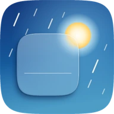
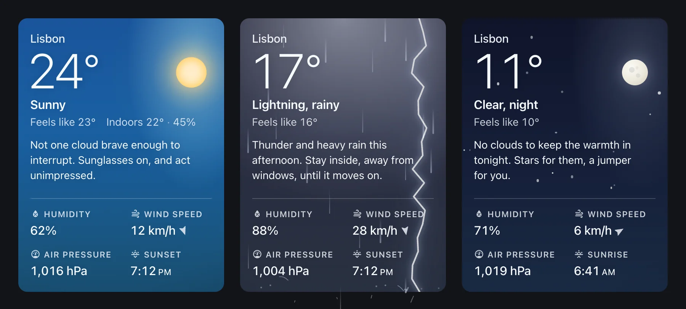
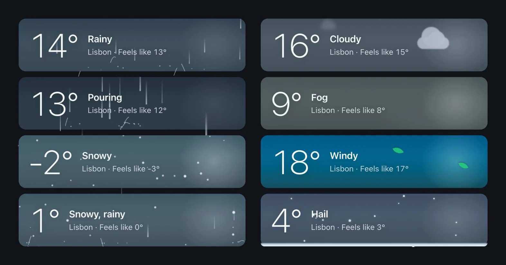
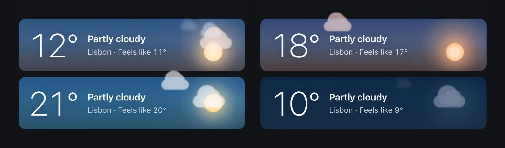
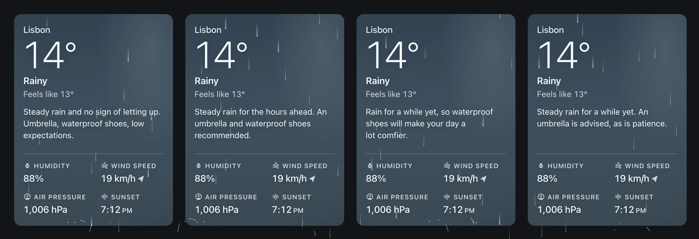
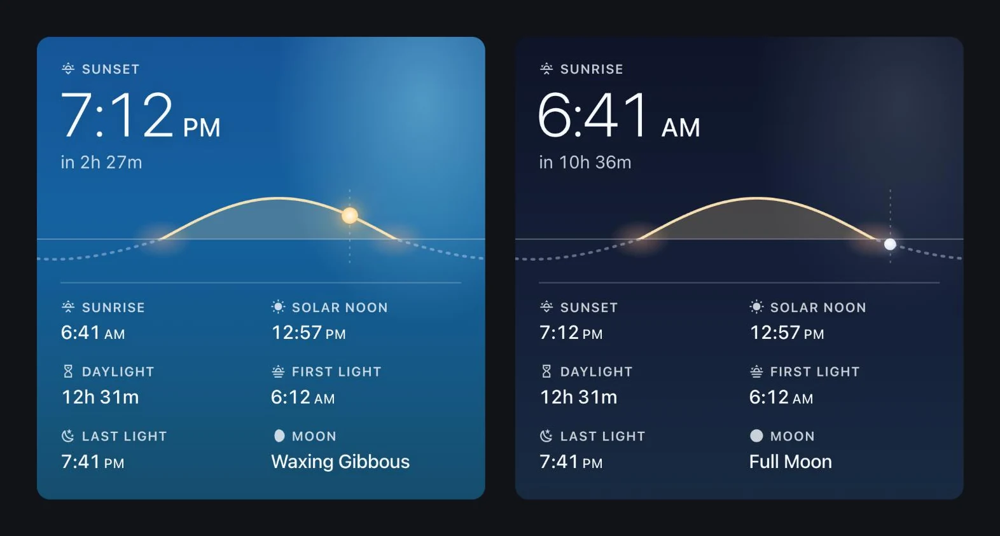
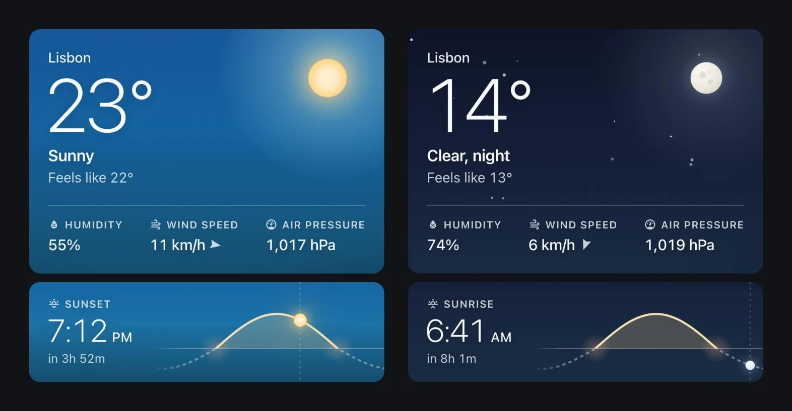
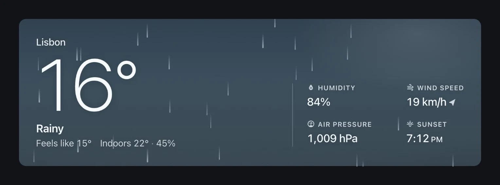
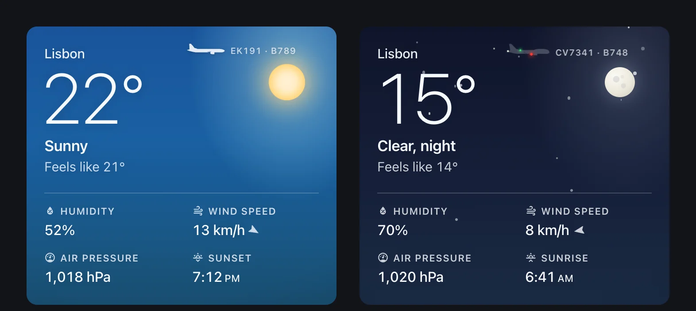
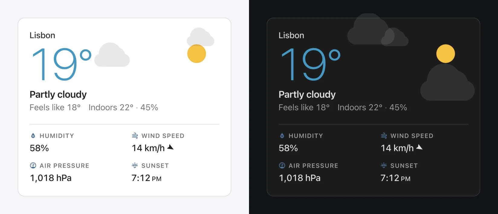

# Animated Weather Card

**Live weather, on your dashboard.**

[](https://github.com/alexsto1an/ha-ani-weather-card/releases)
[](https://hacs.xyz/docs/faq/custom_repositories/)
[](https://github.com/alexsto1an/ha-ani-weather-card/blob/main/LICENSE)



Animated Weather Card turns a Home Assistant weather entity into a living sky. The condition and the time of day set the light. Rain, snow, fog, wind, lightning and clouds move behind the numbers, and the temperature is always the first thing you read. Under the conditions, your AI can write a note about the hours ahead. A matching sun tracker card comes in the same download.

It's free, open source and made for Home Assistant. You can [try it live](https://alexsto1an.github.io/ha-ani-weather-card/) in your browser first, on sample data.

[Live demo](https://alexsto1an.github.io/ha-ani-weather-card/) · [Install](#install) · [Set up](#set-up) · [Examples](#examples) · [Options](#options) · [Troubleshooting](#troubleshooting)

---

## Weather you can see.

Each condition has its own sky and its own motion, and both follow what your weather entity reports. Rain falls at a steady pace and splashes on the card's lower edge. Snow drifts with the wind, the smaller flakes farther away. Fog drifts in layers, leaves blow across on windy days, and lightning lights the sky from above. The live wind speed sets how fast it all moves.



## It follows the sun.

The sky moves through dawn, day, dusk and night with the real sun, read from Home Assistant's `sun.sun`. When the light changes, one sky dissolves into the next over about three seconds.



## Your AI writes the note.

Turn on `show_note` and the card hands Home Assistant's AI the hours ahead: when the rain starts and stops, the high and the low, the gusts, the UV, and when you're out, from your calendar. It writes back a line and a longer note, and the card shows whichever fits. Pick its voice: snarky, calm, friendly or dry. Serious weather always gets plain advice. Every screen you're signed in on shares the one note, rewritten as the forecast changes. It needs Home Assistant 2025.8 or later with an AI Task. [Set it up](#a-note-from-your-ai), or [try each voice](https://alexsto1an.github.io/ha-ani-weather-card/#note) in the live demo.



## A sun tracker to match.

The download includes a second card, just for the sun. It shows the sun's path across the day, with the next sunrise or sunset as the headline. Below are first light, last light, solar noon, the length of the day and the moon phase. Its sky follows the sun in the same palette as the weather card.



## Better together.

Stack a compact sun tracker under the weather card and the two read as one piece. They share your weather entity's sky, their text lines up, and rain falling out of the weather card passes behind the tracker. [Set it up](#weather-and-sun-tracker).



## Fits any frame.

The card works in a narrow phone column, a sections grid or on a wall tablet across the room:

- **Metrics:** they share one row when they fit and fold into a grid when they don't, measured against the actual labels in your language.
- **Wide cards:** the metrics move beside a larger temperature.
- **Short sections rows:** the card steps down to tighter layouts instead of clipping.
- **One line:** `compact: true` gives you a single strip.



## Planes, actually overhead.

Connect the [Flightradar24 integration](https://github.com/AlexandrErohin/home-assistant-flightradar24) and each flight that enters your area crosses the card once. It flies at its real heading, altitude and speed, with its flight number and aircraft type beside it. Each is drawn as its aircraft, from its type: an airliner, a wide-body, a 747, a regional or business jet, a turboprop, a light aircraft or a helicopter, longer for a longer aircraft. Cruising traffic flies small and high, and arrivals come in lower and larger. After dark, a plane is its lights: green or red at the wingtip facing you, flashing white strobes and a red beacon.



## At home in any theme.

Prefer your dashboard's own look? The theme palette drops the sky and draws the weather in your theme's colours, light or dark. Or keep the sky and recolour it: pick per-condition colours in the editor, or define whole gradients in your theme.



## The details.

- **Speaks your language.** Conditions, metric labels and the moon phase come from Home Assistant's own translations. The card's few words of its own are translated into nine languages. Times follow your profile's 12- or 24-hour setting.
- **Your own sensors.** Point the card at your weather station and it shows what they measure: temperature, feels like, humidity, wind and pressure, indoors and out. The sky still follows the forecast.
- **Updates in place.** New readings fade in without a re-render. When the condition changes, the old weather fades out as the new one arrives.
- **Rests when unseen.** Motion pauses while the tab is hidden or the card is scrolled out of view. It can also pause while the window is in the background.
- **Respects reduced motion.** If reduced motion is on in your system settings, the sky stays still: the same colour and light, with no moving weather.
- **Readable in every sky.** Text sits above the weather, and every built-in sky is tested to meet WCAG AA contrast for the card's text. Screen readers hear temperature and condition changes, and decorative layers are hidden from them.
- **Light to load.** The card is about 49 KB gzipped, plus GSAP from a CDN. The visual editor, the note writer, the planes and the developer panel load only when they're needed.
- **Set up visually.** Every weather card option is in the visual editor. YAML is there when you want it.

## Built with AI.

AI helped build this card. Its code, tests and documentation were developed with an AI assistant, under my direction. I review every change, and each one has to pass the test suite before I merge it. The card runs every day on my own dashboard. If you'd rather not use software made with AI, you know before you install.

---

## Install

The [setup guide](https://alexsto1an.github.io/ha-ani-weather-card/setup/) walks through every step, from HACS to the weather note, with troubleshooting.

### What you need

- **A weather entity.** Any weather integration works: Met.no, OpenWeatherMap, AccuWeather, Pirate Weather, the National Weather Service and others.
- **Internet access for each device that shows the dashboard.** The card loads [GSAP](https://gsap.com), its animation library, from `cdnjs.cloudflare.com`. If a device can't reach it, the card still shows the sky and every value, just without motion.
- **Optional:** an AI integration with an AI Task (Home Assistant 2025.8 or later) for the weather note, the [Moon](https://www.home-assistant.io/integrations/moon/) integration for the tracker's moon phase, and the [Flightradar24 integration](https://github.com/AlexandrErohin/home-assistant-flightradar24) for planes.

The card ships as five files that sit in the same folder:

| File | What it is |
| --- | --- |
| `animated-weather-card.js` | Both cards. This is the only dashboard resource you add. |
| `animated-weather-card-editor.js` | The visual editor. It loads the first time you open the card's settings. |
| `animated-weather-card-note.js` | The note writer. It loads only for cards that write their own note (`show_note`). |
| `animated-weather-card-planes.js` | The planes. It loads only for cards with a flights sensor (`flights_entity`). |
| `animated-weather-card-dev.js` | The developer panel. It loads only for cards with `dev_mode: true`, so a manual install can leave it out. |

### HACS

The card isn't in the default HACS store yet, so add it as a custom repository:

1. Open HACS and select ⋮ (top right) → **Custom repositories**.
2. Paste `https://github.com/alexsto1an/ha-ani-weather-card` and choose the type **Dashboard**.
3. Search for **Animated Weather Card** and download it.
4. Refresh your browser.

HACS adds the dashboard resource for you when your dashboards are managed in the UI. For YAML-mode dashboards, add it yourself:

```yaml
resources:
  - url: /hacsfiles/ha-ani-weather-card/animated-weather-card.js
    type: module
```

### Manual

1. Download [`animated-weather-card.js`](https://github.com/alexsto1an/ha-ani-weather-card/releases/latest/download/animated-weather-card.js), [`animated-weather-card-editor.js`](https://github.com/alexsto1an/ha-ani-weather-card/releases/latest/download/animated-weather-card-editor.js) and [`animated-weather-card-note.js`](https://github.com/alexsto1an/ha-ani-weather-card/releases/latest/download/animated-weather-card-note.js) from the [latest release](https://github.com/alexsto1an/ha-ani-weather-card/releases/latest). Add [`animated-weather-card-planes.js`](https://github.com/alexsto1an/ha-ani-weather-card/releases/latest/download/animated-weather-card-planes.js) if you fly planes, and [`animated-weather-card-dev.js`](https://github.com/alexsto1an/ha-ani-weather-card/releases/latest/download/animated-weather-card-dev.js) if you want developer mode. You can also build them from source with `npm install && npm run build`.
2. Copy the files to your `config/www/` folder. If you had to create `www/`, restart Home Assistant once so `/local/` is served.
3. Go to **Settings → Dashboards → ⋮ → Resources → Add resource** and add:
   - URL: `/local/animated-weather-card.js?v=1`
   - Type: **JavaScript module**

   If Resources isn't shown, turn on Advanced mode in your user profile. For YAML-mode dashboards:

   ```yaml
   resources:
     - url: /local/animated-weather-card.js?v=1
       type: module
   ```

4. Refresh your browser.

To update a manual install, overwrite the files and raise the `?v=` number in the resource URL so browsers fetch the new version. The editor, the note writer, the planes and the developer panel pick up the same `?v=` automatically.

> **Load the card from one place only.** If you switch between HACS (`/hacsfiles/`) and a manual install (`/local/`), remove the old resource. Otherwise the second copy can't register, and you keep running whichever version loaded first.

## Set up

1. Edit your dashboard, select **Add card** and search for **Animated Weather Card**.
2. Pick your weather entity. That's enough to start.
3. Adjust the rest in the editor's sections:
   - **Entities**
   - **Display**
   - **Weather note**
   - **Day and night**
   - **Advanced**
   - **Weather engine**
   - **Colors**

For the sun tracker, search for **Animated Sun Tracker** and pick `sun.sun`.

Or in YAML:

```yaml
type: custom:animated-weather-card
entity: weather.forecast_home
```

## Examples

Every example below is a complete card configuration. Replace the entity IDs with your own.

### The essentials

The sky follows `sun.sun` on its own. Add `sun_entity` to also show the next sunset (or, at night, sunrise) beside the other metrics.

```yaml
type: custom:animated-weather-card
entity: weather.forecast_home
sun_entity: sun.sun
```

### Your own sensors

Your sensors take the place of the weather entity's values, and a wind speed sensor also sets how fast the weather moves. A wind direction sensor can report degrees or a compass point like `NW`. Any sensor that's unavailable falls back to the weather entity. Without `feels_like_entity`, the card uses the entity's apparent temperature if it reports one. Indoor readings sit under the condition.

```yaml
type: custom:animated-weather-card
entity: weather.forecast_home
name: Garden
sun_entity: sun.sun
outdoor_sensor_entity: sensor.garden_temperature
feels_like_entity: sensor.garden_apparent_temperature
humidity_sensor_entity: sensor.garden_humidity
wind_speed_sensor_entity: sensor.garden_wind_speed
wind_direction_sensor_entity: sensor.garden_wind_direction
pressure_sensor_entity: sensor.barometer
indoor_temperature_entity: sensor.living_room_temperature
indoor_humidity_entity: sensor.living_room_humidity
```

### Weather and sun tracker

This is the pairing in the screenshot above. `show_sun: false` leaves the next sunset to the tracker, which frees a slot so the weather card's three remaining metrics can share one row. `weather_entity` gives the tracker the weather card's sky.

```yaml
type: vertical-stack
cards:
  - type: custom:animated-weather-card
    entity: weather.forecast_home
    sun_entity: sun.sun
    show_sun: false
  - type: custom:animated-sun-tracker-card
    sun_entity: sun.sun
    moon_entity: sensor.moon_phase
    weather_entity: weather.forecast_home
    compact: true
```

### Two strips

Both cards in compact form. Together they take about 200 px: the temperature, the condition and the next sunrise or sunset.

```yaml
type: vertical-stack
cards:
  - type: custom:animated-weather-card
    entity: weather.forecast_home
    compact: true
  - type: custom:animated-sun-tracker-card
    sun_entity: sun.sun
    weather_entity: weather.forecast_home
    compact: true
```

### Sections view

Both cards size themselves in the sections view, and you can resize them freely:

- **Weather card:** 12 columns × 4 rows by default, 12 × 5 with a note, or 12 × 2 compact.
- **Sun tracker:** 12 × 6 by default, or 12 × 2 compact.

If you give a card fewer rows, it steps down to fit, and stops at the first layout that does:

1. The line under the condition goes first.
2. Then the temperature shrinks.
3. Then the location goes.
4. Then the metric labels go, and the temperature shrinks again.

A note gives way before any of these: the spacing tightens to keep it whole, then it shortens to one line, then the temperature shrinks to keep that, then it goes.

On a phone, the default four rows show the card without its location and without the line under the condition, with the metrics and their labels in a grid. With a note, its five rows keep everything, with a smaller temperature and the note on one line.

```yaml
type: custom:animated-weather-card
entity: weather.forecast_home
sun_entity: sun.sun
grid_options:
  columns: 12
  rows: 3
```

### Wall tablet

A panel view gives the card the whole screen. Above 640 px wide, the metrics move to the right of a larger temperature. This is a view configuration: paste it in the dashboard's raw configuration editor, under `views:`.

```yaml
title: Weather
type: panel
cards:
  - type: custom:animated-weather-card
    entity: weather.forecast_home
    sun_entity: sun.sun
    indoor_temperature_entity: sensor.living_room_temperature
    indoor_humidity_entity: sensor.living_room_humidity
```

### Blend with your theme

The theme palette uses your dashboard's card background and text colours, in light and dark themes.

```yaml
type: custom:animated-weather-card
entity: weather.forecast_home
color_palette: theme
```

### Planes overhead

This needs the [Flightradar24 integration](https://github.com/AlexandrErohin/home-assistant-flightradar24). Set `show_flight_labels: false` to fly the planes without their tags.

Each flight is drawn from the side as its aircraft, picked from the ICAO type code Flightradar24 reports: a narrow-body airliner (A320, 737, E190), a wide-body (787, 777, A350), a four-engine jet (747, A380), a jet with its engines at the tail (CRJ, MD-80, and business jets at their own length), a turboprop (ATR, Dash 8), a light aircraft (Cessna, Piper) or a helicopter. An unknown type flies as an airliner. Longer aircraft look longer, though less than in life, so a low 747 never covers the temperature. After dark, with the sky palette, a plane is its lights: steady green at the near wingtip of a plane flying right and red flying left, white strobes that flash twice, a red beacon and a white tail light. With `color_palette: theme` it stays a silhouette in your theme's colour.

```yaml
type: custom:animated-weather-card
entity: weather.forecast_home
sun_entity: sun.sun
flights_entity: sensor.flightradar24_current_in_area
```

### A note from your AI

The card can write a sentence under the conditions: a remark on the weather, what's coming in the next hours and what to wear. It's snarky by default.

```yaml
type: custom:animated-weather-card
entity: weather.forecast_home
sun_entity: sun.sun
show_note: true
# Optional
note_tone: calm                 # snarky, calm, friendly or dry
note_calendar: calendar.family  # when you're out, for what to wear
```

**What it needs.** Home Assistant writes the note with its AI Task, so it works with whichever AI you've set up there. You need Home Assistant 2025.8 or later and an AI integration that provides an AI Task: OpenAI, Google, Ollama, OpenRouter, Anthropic (2025.12 or later) or Home Assistant Cloud. The card uses the default AI Task from Settings → System → AI, or the one you name in `note_ai_task_entity`. Your API key stays in Home Assistant; the card never sees it.

**How it's written.**

- **Facts first.** The card reads the hourly forecast and works out what it says: when the rain starts and stops, the high and low, gusts, UV, and how it'll feel when you're out. The AI only puts those facts into words, and is told never to invent a time or a temperature.
- **Four voices.** `snarky`, the default, is theatrical and a little unhinged, in the spirit of CARROT Weather: the weather has motives and the joke lands at the end. `calm` is plain and impersonal, like Apple Weather. `friendly` talks to you like a friend who checked the forecast for you. `dry` is deadpan: short, flat and mildly unimpressed.
- **Your calendar.** With `note_calendar`, the card reads the next 12 hours of events and says what to wear for each stretch you're out. Timed events count; all-day, cancelled and online ones (a location that's a link) don't, and events less than half an hour apart count as one stretch. Only the times reach the AI, never an event's name, place or description.
- **Serious weather gets no jokes.** Thunderstorms, hail, heavy rain, gale-force gusts and dangerous cold or heat switch any voice to plain advice.
- **Your language.** It writes in your profile's language, with your units and your 12- or 24-hour clock.
- **Two lengths.** It writes a one-line version for short frames and a longer one where there's room, and shows one whole or not at all.
- **No stale flash.** When you come back to the card and a new note is due, a short status takes its place while it's written (reading the forecast, then writing the note), and the new note types itself in, rather than the old one showing first. With reduced motion, it's simply there.

**What it costs.** The note is rewritten after an hour, or sooner when the forecast changes, and only while a screen is showing the card. Every screen you're signed in on shares one note, through your Home Assistant user. Each note is one small request, about 1,000 tokens in and 60 out: with the settings below, about $0.20 a month for a card on all day.

If there's no AI Task, or a note can't be written, the card shows no note and is otherwise the same. The browser console says why, and so does the editor.

#### Choosing the AI

The card has already worked out the facts, so the AI only writes two short sentences. A small, fast model does it best, with as little thinking as it allows: thinking adds seconds and cost to every note, and nothing to it. Set this up in the AI integration's **AI Task** options (Settings → Devices & services → the integration → the AI Task's settings), not its conversation agent's, then make it the default in Settings → System → AI or pick it in the card's editor.

**Anthropic.** Home Assistant's recommended settings use Claude Haiku 4.5 with thinking on. Turn **Recommended** off and choose:

| Setting | Choose |
| --- | --- |
| Model | `claude-haiku-5-5`, newer and about a tenth of Haiku 4.5's price |
| Maximum tokens | 3000, the default. It's only a ceiling; lower risks a note cut off, and then none |
| Thinking effort | Low, the least Haiku 5.5 offers |
| Code execution, web search, web fetch | Off |

On Haiku 4.5, set **Thinking budget** to 0 instead: anything under 1024 turns thinking off.

**OpenAI.** Home Assistant's recommended model is `gpt-4o-mini`, which OpenAI retires in January 2027. Turn **Recommended** off and choose `gpt-6-luna`, with **Reasoning effort** set to None, and leave web search and the code interpreter off. The image model doesn't matter for the note.

**Other integrations** (Google, Ollama, OpenRouter, Home Assistant Cloud): pick their smallest current model and turn thinking or reasoning down as far as it goes. A local model through Ollama costs nothing per note, but needs to follow a JSON schema: the card asks for structured output.

### A note from an entity

The card can also show a sentence from any entity whose state is text: a text helper, a template sensor, or a summary sensor from your weather integration, such as Pirate Weather's. An entity is used instead of the AI.

- **The state is the one-line version.** Keep it to about 40 characters, so it fits a phone.
- **A `note` attribute, if there is one, is the longer version.** The card shows it where there's room for two lines. Keep it to about 90 characters.
- **A `generated_at` attribute marks when it was written.** The card hides the note 3 hours later (`note_max_age`), so a note about this afternoon's rain isn't still up tonight. The AI's own notes do the same.

With a note, from either source, the card asks the sections view for five rows. On a phone, that's room for the one-line version. With four, the note gives way.

```yaml
type: custom:animated-weather-card
entity: weather.forecast_home
sun_entity: sun.sun
note_entity: input_text.weather_note
```

### Just the numbers

This hides the metric labels and icons, and marks the indoor reading with a house icon instead of the word.

```yaml
type: custom:animated-weather-card
entity: weather.forecast_home
indoor_temperature_entity: sensor.living_room_temperature
indoor_style: icon
show_attribute_labels: false
show_attribute_icons: false
```

### A calmer card

This keeps all the weather inside the card, stops the jolt on lightning strikes, and also pauses while the browser window is in the background. For a sky with no motion at all, set `animate: false`.

```yaml
type: custom:animated-weather-card
entity: weather.forecast_home
spill_particles: false
disable_lightning_shake: true
auto_pause: true
```

### Your own colours

Each `_bg` colour becomes a full sky for that condition: lighter overhead, deeper at the horizon, with the same shading behind the metrics as the built-in skies. It replaces that condition's sky at every time of day.

```yaml
type: custom:animated-weather-card
entity: weather.forecast_home
custom_colors:
  sunny_bg: "#2f80d1"
  cloudy_bg: "#6b7a8f"
  rainy_bg: "#3f5168"
  text_color: "#ffffff"
  rain_color: "rgba(220, 235, 255, 0.8)"
```

### Skies from your theme

For full control, set a sky per condition in a [Home Assistant theme](https://www.home-assistant.io/integrations/frontend/). Any CSS background works. This covers all fifteen skies, including those `custom_colors` doesn't reach, such as pouring and storms. The variable names are listed under [Conditions](#conditions).

```yaml
# configuration.yaml → frontend: themes:, or a file in themes/
my_theme:
  weather-sunny-background: "linear-gradient(180deg, #5aa0e6 0%, #2a6db5 60%, #1d4f87 100%)"
  weather-pouring-background: "linear-gradient(180deg, #4a5566 0%, #2d3542 100%)"
  weather-clear-night-background: "linear-gradient(180deg, #0b1026 0%, #1b2547 100%)"
```

### A stormier sky

The weather engine scales the animation. For the editor's slider ranges and what YAML accepts, see [Weather engine](#weather-engine).

```yaml
type: custom:animated-weather-card
entity: weather.forecast_home
engine_settings:
  windSpeed: 3.5
  rainCount: 2
  cloudCount: 5
  cloudBaseSize: 1.3
  splashBounce: 110
```

### Day and night by the clock

This follows fixed hours instead of the sun, for example when your `sun.sun` doesn't match where the dashboard hangs.

```yaml
type: custom:animated-weather-card
entity: weather.forecast_home
enable_day_night_cycle: true
sunrise_hour: 7
sunset_hour: 19
```

## Options

### Weather card

`type: custom:animated-weather-card`

**Entities**

| Option | Default | Description |
| --- | --- | --- |
| `entity` | required | Your weather entity |
| `name` | entity's name | The location shown above the temperature |
| `sun_entity` | — | Usually `sun.sun`. Adds the next sunset (by day) or sunrise (by night) to the metric row. The sky follows `sun.sun` with or without it |
| `outdoor_sensor_entity` | — | A temperature sensor to show instead of the weather entity's temperature |
| `feels_like_entity` | — | An apparent temperature sensor. Without it, the card uses the weather entity's `apparent_temperature` if it has one |
| `humidity_sensor_entity` | — | A humidity sensor to show instead of the weather entity's humidity |
| `pressure_sensor_entity` | — | A pressure sensor to show instead of the weather entity's pressure |
| `wind_speed_sensor_entity` | — | A wind speed sensor to show instead of the weather entity's wind speed, in its own unit. It also sets how fast the weather moves |
| `wind_direction_sensor_entity` | — | A wind direction sensor for the wind arrow, in degrees or a compass point like `NW` |
| `indoor_temperature_entity` | — | An indoor temperature, shown under the condition |
| `indoor_humidity_entity` | — | An indoor humidity, shown beside it |
| `flights_entity` | — | A Flightradar24 area sensor, usually `sensor.flightradar24_current_in_area` |

**Display**

| Option | Default | Description |
| --- | --- | --- |
| `compact` | `false` | One line about 88 px tall: the temperature and condition, with the location and "feels like" beside them. Two rows in the sections view |
| `show_location` | `true` | Show the location name |
| `show_attributes` | `true` | Show the metric row: humidity, wind, pressure and sunset |
| `show_attribute_labels` | `true` | Show the metric labels |
| `show_attribute_icons` | `true` | Show the metric icons |
| `show_sun` | `true` | Show the next sunset or sunrise in the metric row. Needs `sun_entity` |
| `show_indoor` | `true` | Show the indoor reading |
| `indoor_style` | `label` | How the indoor reading starts: `label` (the word "Indoors", translated), `icon` (a house) or `both` |
| `show_flight_labels` | `true` | Show the flight number and aircraft type beside each plane. Labels only appear in open sky, never over the temperature |
| `color_palette` | `default` | `default` for the sky, or `theme` for your dashboard's colours |

**Weather note**

| Option | Default | Description |
| --- | --- | --- |
| `show_note` | `false` | Write a note under the conditions with Home Assistant's AI Task, from the forecast. Needs Home Assistant 2025.8 or later and an AI integration. Five rows in the sections view |
| `note_tone` | `snarky` | The note's voice: `snarky`, `calm`, `friendly` or `dry`. Serious weather always gets plain advice |
| `note_ai_task_entity` | the default | The AI Task entity that writes it. Without it, the default from Settings → System → AI |
| `note_calendar` | — | The calendar your hours out come from, or a list of them, for what to wear. Timed events count; all-day, cancelled and online ones don't. Only the times reach the AI |
| `note_entity` | — | Show a note from an entity instead of the AI: a text helper, a template sensor or a summary sensor. Its state is the one-line version |
| `note_attribute` | `note` | The entity's attribute with a longer version, shown where there's room for two lines |
| `note_max_age` | `180` | Minutes after a note was written (an entity's `generated_at` attribute) that it's hidden. `0` keeps it up. An entity note without `generated_at` stays until the entity changes it |

**Motion**

| Option | Default | Description |
| --- | --- | --- |
| `animate` | `true` | Set to `false` for a still sky: the condition's colour and light, no motion |
| `spill_particles` | `true` | Let rain, snow, sleet and leaves fall out of the card onto the dashboard, and clouds drift a little above its top edge. Turn it off to keep all weather inside the card |
| `disable_lightning_shake` | `false` | Turn off the card's small jolt on lightning strikes |
| `auto_pause` | `false` | Also pause while the browser window is in the background. Cards always pause while the tab is hidden or the card is off-screen |
| `dev_mode` | `false` | A developer panel with sample data for trying every condition. Needs `animated-weather-card-dev.js` |

**Day and night**

| Option | Default | Description |
| --- | --- | --- |
| `enable_day_night_cycle` | `false` | Follow the clock instead of the sun |
| `sunrise_hour` | `6` | The hour the day begins, 0–23 |
| `sunset_hour` | `20` | The hour the night begins, 0–23 |

#### Weather engine

Set these under `engine_settings:`. The editor's sliders cover the useful range, and YAML accepts more. Values outside the YAML range fall back to the default.

| Option | Default | Editor | YAML | Description |
| --- | --- | --- | --- | --- |
| `windSpeed` | `2` | 0.5–5 | 0.1–15 | How strongly the live wind speed drives the motion |
| `rainCount` | `1` | 0.5–3× | 0.1–10× | Amount of rain |
| `snowCount` | `1` | 0.5–3× | 0.1–10× | Amount of snow |
| `leafCount` | `1` | 0.5–3× | 0.1–10× | Amount of leaves on windy days |
| `cloudCount` | `3` | 1–6 | 1–20 | Number of clouds |
| `cloudBaseSize` | `1` | 0.5–2× | 0.3–2.5× | Cloud size |
| `splashBounce` | `80` | 40–120 | 40–120 | How high raindrops spring back after they splash |

#### Custom colours

Set these under `custom_colors:`. Leave one out to keep the built-in colour.

| Option | Accepts | Description |
| --- | --- | --- |
| `sunny_bg`, `cloudy_bg`, `rainy_bg`, `stormy_bg`, `snowy_bg`, `windy_bg` | Hex | Replaces that condition's sky with one built from this colour. It applies to that condition only: `rainy_bg` leaves pouring rain alone. Colorized palette only |
| `text_color` | Hex, `rgb()`, `rgba()` or a colour name | All text on the card |
| `sun_color` | Same | The sun |
| `rain_color` | Same | Raindrops |
| `snow_color` | Same | Snowflakes |

### Sun tracker card

`type: custom:animated-sun-tracker-card`

| Option | Default | Description |
| --- | --- | --- |
| `sun_entity` | required | Usually `sun.sun` |
| `moon_entity` | — | A moon phase sensor, such as the Moon integration's `sensor.moon_phase` |
| `weather_entity` | — | Share this weather entity's sky: its condition at the current time of day. Without it, the sky is clear |
| `compact` | `false` | One line about 110 px tall: the next sunrise or sunset beside the sun's path. Two rows in the sections view |
| `title` | — | A title above the headline |
| `show_header` | `true` | Show the next sunrise or sunset and the time until it |
| `show_details` | `true` | Show first and last light, solar noon, daylight and the moon phase |
| `color_palette` | `default` | `default` for the sky, or `theme` for your dashboard's colours |

`custom_colors` and theme skies apply to the weather card only.

## Conditions

The card reads the standard Home Assistant conditions. It also understands free-text conditions from other integrations, such as "light rain", "thunderstorm", "mist" or "heavy snow", and picks the closest sky.

| Home Assistant condition | What you see | Theme variable |
| --- | --- | --- |
| `sunny` | Clear sky and the sun | `weather-sunny-background` |
| `clear-night` | Stars and the moon | `weather-clear-night-background` |
| `partlycloudy` | The sun between drifting clouds | `weather-partly-cloudy-background` |
| `cloudy` | Overcast, with drifting clouds | `weather-cloudy-background` |
| `fog` | Drifting fog | `weather-foggy-background` |
| `rainy` | Rain that splashes on the lower edge | `weather-rainy-background` |
| `pouring` | Heavy rain | `weather-pouring-background` |
| `lightning`, `lightning-rainy` | Storm rain and lightning | `weather-stormy-background` |
| `snowy` | Snow drifting with the wind | `weather-snowy-background` |
| `snowy-rainy` | Snow and rain together | `weather-snowy-rainy-background` |
| `hail` | Sleet | `weather-sleety-background` |
| `windy`, `windy-variant` | Leaves on the wind | `weather-windy-background` |
| `exceptional` | A clear sky | `weather-sunny-background` |

Free-text conditions can also reach these skies:

| Free text | Sky | Theme variable |
| --- | --- | --- |
| "light rain", "light drizzle" | Light rain | `weather-light-rain-background` |
| "sleet" | Sleet | `weather-sleety-background` |
| Snow with thunder | Snow and lightning | `weather-snowy-stormy-background` |
| Sleet with thunder | Sleet and lightning | `weather-sleety-stormy-background` |

## Languages

Both cards follow your Home Assistant profile: its language and its 12/24-hour time format.

- **From Home Assistant:** the weather condition, the moon phase, and the humidity, wind and pressure labels come from Home Assistant's own translations.
- **The cards' own words:** "Feels like", "Indoors", sunrise and sunset, and the sun tracker's labels are translated into:
  - English
  - German
  - Spanish
  - French
  - Italian
  - Dutch
  - Polish
  - Portuguese
  - Romanian

Other languages show English for those words. The strings live in [`src/localize.ts`](src/localize.ts), and corrections and new languages are welcome.

## Troubleshooting

**"Custom element doesn't exist: animated-weather-card"**
The resource isn't loaded. Check **Settings → Dashboards → Resources**, then reload the page. In the Companion app, reset the frontend cache from the app's settings.

**Still the old version after an update**
Your browser is using a cached copy. For a manual install, raise the `?v=` number in the resource URL. In both cases, reload the page.

**"name has already been used" in the browser console**
The card is loaded twice, usually from both `/hacsfiles/` and `/local/`. Remove one of the resources.

**The sky shows, but nothing moves**
Check these, in order:

1. Reduced motion is on in your system settings.
2. `animate` is `false`.
3. The device couldn't load GSAP from `cdnjs.cloudflare.com`. The browser console says "GSAP unavailable — animations disabled".

**The settings panel stays empty**
`animated-weather-card-editor.js` must be in the same folder as `animated-weather-card.js`.

**No sunset in the metric row**
Add `sun_entity: sun.sun`.

**No note under the conditions**
The note needs Home Assistant 2025.8 or later and an AI Task: the default one from Settings → System → AI, or `note_ai_task_entity`. The editor's **Weather note** section says what's missing, and so does the browser console. The card only writes while it's on screen, and after a failure it tries again ten minutes later. On a manual install, `animated-weather-card-note.js` has to sit next to `animated-weather-card.js`.

**Planes don't appear**
Planes only fly in a few cases:

- Only flights that enter your area after the dashboard loads fly. Flights already overhead stay put, so reloading doesn't replay them.
- Planes on the ground wait until they take off.
- Flights that arrive while the card is paused are skipped.
- At most three planes cross at once.
- On a manual install, `animated-weather-card-planes.js` has to sit next to `animated-weather-card.js`. The browser console says so if it can't load.

To check the setup, the developer panel's **Fly a plane** button sends one across in `dev_mode`.

## Contributing

Bug reports, ideas, translations and pull requests are all welcome. Start with [CONTRIBUTING.md](CONTRIBUTING.md), and see the [changelog](CHANGELOG.md) for what's new.

```bash
npm install
npm run dev          # rebuild on change
npm test             # Vitest suite
npm run type-check
npm run build        # the five bundles, written to the repository root
```

To try a change in Home Assistant, copy the five `.js` files to `config/www/` and add `dev_mode: true` to a card. You get sample data and a panel for trying every condition and time of day.

### How it's built

- **Five bundles,** built with esbuild. The card bundle loads the editor, the note writer, the planes and the developer panel from its own folder when they're needed, so most dashboards only download the first.
- **One animation class per kind of weather,** on a shared lifecycle base and run by an animation controller. Rain, snow and sleet draw from fixed pools of recycled particles.
- **Skies defined in OKLCH,** with tests for contrast at every point where text sits.

```
src/
├── animated-weather-card.ts        # The weather card
├── sun-tracker-card.ts             # The sun tracker card and its editor
├── animated-weather-card-editor.ts # Entry point of the editor bundle
├── config-editor.ts                # Visual editor for the weather card
├── animated-weather-card-dev.ts    # Entry point of the developer panel bundle
├── dev-panel.ts                    # Developer panel (dev_mode)
├── animated-weather-card-note.ts   # Entry point of the note writer bundle
├── note-generator.ts               # Writes the note with Home Assistant's AI Task
├── animation-controller.ts         # Starts and stops animations per condition
├── modular-integration-bridge.ts   # Builds each animation with its settings
├── base-animation.ts               # Lifecycle base class for animations
├── rain-animation.ts, snow-animation.ts, sleet-animation.ts, wind-animation.ts,
│   lightning-animation.ts, clouds-animation.ts, fog-animation.ts,
│   stars-animation.ts, sun-animation.ts
├── animated-weather-card-planes.ts # Entry point of the planes bundle
├── planes-animation.ts             # Plane fly-overs
├── aircraft.ts                     # Each aircraft family, drawn from its real dimensions
├── particle-pool.ts                # Recycled particles for rain, snow and sleet
├── gsap-effects.ts                 # Clouds, leaves, swooshes and fog
├── flight-tracker.ts               # Flightradar24 arrivals for plane fly-overs
├── sky.ts                          # Sky palettes (OKLCH), phases and contrast checks
├── localize.ts                     # The cards' own strings, times and durations
├── time-manager.ts                 # Optional clock-based day/night cycle
├── weather-data.ts                 # Reads the weather entity and sensors
├── color-utils.ts                  # custom_colors
├── constants.ts, types.ts, utils.ts
└── styles/                         # CSS for the card, editor and developer panel
```

## Credits

- [GSAP](https://gsap.com) moves the weather.
- [Material Design Icons](https://pictogrammers.com/library/mdi/), through Home Assistant, draw the metric icons.
- The [Flightradar24 integration](https://github.com/AlexandrErohin/home-assistant-flightradar24) by AlexandrErohin supplies the planes.
- The Home Assistant community gave feedback along the way. Thank you.

## License

[MIT](LICENSE)

## Support

If the card earns its place on your dashboard, you can buy me a coffee.

[](https://ko-fi.com/Y8Y1124U41)
